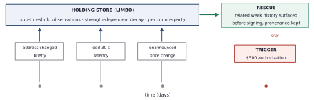
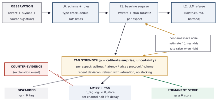
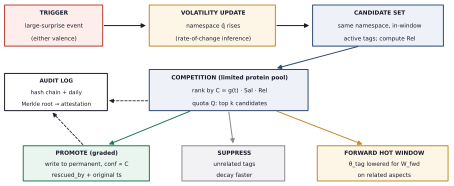
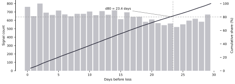

::: abstract
**Abstract.** Payments between autonomous agents are authorized today with no record of how the counterparty has behaved over time. Every current defense layer, spending policies, transaction simulation, global threat intelligence, evaluates the moment of decision; but the early signs of counterparty fraud are individually too minor for any memory system to retain, and by the time the decision arrives they have long been discarded. We propose NonameTrust (NNT), a counterparty memory layer that adapts a documented neuroscience mechanism, synaptic tagging and capture, to agent memory: observations that fall below the write threshold are held in a bounded limbo store instead of being dropped, and are retroactively promoted to durable memory when a related significant event occurs, so that the evidence surfaces at exactly the moment a large authorization requires it; a fleet-wide consolidation signal extends the same mechanism across participants, letting one confirmed loss promote related traces held by every other. We tested the mechanism's precondition on the Stellar network's own data: across a full census we identified 76,221 loss cases over ten years, and in a pre-registered, controlled backtest we measured that 93.0% of victim wallets carried at least one recoverable precursor signal in the 30 days before the loss, against 47.5% of a matched control group. The difference is both statistically and practically significant, and the findings directly calibrate two production parameters, the weighting of signal channels and the length of the holding window, from the data itself. The long-term aim is plain: as agent counts and authorization ceilings grow, counterparty memory becomes as fundamental an infrastructure layer as the payment rail itself, and NNT is designed to be that layer's reference implementation and open measurement standard.
:::

## 1. Introduction

The direction of the software economy is settled: AI agents are ceasing to be tools that merely produce content and are becoming economic actors. Agents that hold their own wallets, discover services, compare prices and authorize payment without human sign-off are operational today, not experimental, and the payment standard of this economy is backed by the industry's largest players. The defining question of the coming period is not how intelligent agents will be but how much authority they can be given: the spending ceiling granted to an agent is a direct function of the trust its owner can place in it, and no infrastructure layer carries that trust today. The limit on agent autonomy will be set not by intelligence but by trust. This paper builds part of that layer.

With x402 and MPP live on mainnet [10], an economy in which software pays software is taking shape: per-request API fees, streaming micropayments, procurement that runs without human approval. A single agent's counterparty count reaches into the hundreds, and no human reviews those relationships one by one. The security assumption of this architecture is that each transaction can be evaluated on its own; the starting point of this paper is that against counterparty fraud this assumption fails structurally.

One of the known playbooks of counterparty fraud is trust building: a clean history is assembled through small, uneventful interactions, then a single large request lands the blow. In other playbooks the persuasion happens largely off-chain, on storefront sites and messaging channels, and only its shadow is visible on-chain: unusual asset invites, lure-flavored memo texts, the distinctive footprint of the fraudulent account itself. In either case, early warning signs appear in the period before the loss, and each of them is insignificant at the moment it occurs. None of the memory systems we have reviewed retains them, because in the published designs a record's importance is fixed at the moment it is written. When the decision arrives, every check reports clean; the evidence that mattered was discarded weeks earlier as noise. The losses show that this model is not marginal: on-chain scam losses measured at least 14 billion dollars globally in 2025, with the same report projecting that the figure may reach 17 billion as more addresses are attributed [8], and a two-year measurement of address poisoning, the attack that targets transaction history itself, counted over 270 million attempts against 17 million targets on Ethereum and Binance Smart Chain between July 2022 and June 2024 [12].

While preparing this study we measured a less visible layer of the problem: the evidence itself evaporates. Stellar's public Horizon service currently serves only about 14 months of history; ledgers older than that are unreachable through the standard endpoints (HTTP 410). The warning signs in a counterparty's past are not merely judged unimportant and dropped; even if kept on-chain, the network's official access window silently rolls past them. The full history survives in archive layers (Hubble, BigQuery), but no system that decides at signing time looks there. Beneath the claim that no deployed system retains these signals lies the infrastructure's own forgetfulness: a memory layer must exist as a separate component precisely because the evidence has to be distilled while it is still reachable.

## 2. Current defense layers

Four layers protect agent payments today, and all four evaluate either a snapshot of the decision moment or the experience of others. Table 1 summarizes the layers and their blind spots.

| Layer | Examples | Blind spot |
|----------------------|----------------------------------|------------------------------------------------------------|
| Static rules | Spending limits, allowlists, session keys | Trust is granted once at setup; later deterioration of a listed counterparty is invisible |
| Point-in-time analysis | Transaction simulation | Shows what this transaction does right now; carries no history |
| Global threat intelligence | Blocklist screening, KYT | Recognizes known bad actors; fresh addresses always look clean |
| Insurance | Transaction protection | Compensates after the loss |
| First-party counterparty memory | The subject of this paper | A longitudinal record of the agent's own experience with each counterparty |

Table: Table 1. Today's layers of agent payment security.

Recent work on agent-to-agent finance names the missing piece directly: institutional-scale agent payment requires mandate evidence, budget evidence and counterparty evidence [9]. The scope of this paper is counterparty-originated deception: trust-building fraud, behavioral drift and history poisoning. Attacks on compromised agent infrastructure are out of scope; their remedy is isolation and privilege confinement.

## 3. Biological foundation: synaptic tagging and capture

The mechanism we propose originates in a neuroscience finding about the fate of weak memories. Frey and Morris [1] showed that a weak experience leaves a short-lived tag at the synapse but cannot trigger the protein synthesis required for a durable record; left alone, the trace fades within hours. If a significant event occurs nearby in time, the plasticity proteins it releases are captured by tagged synapses, and the weak memory that was about to vanish becomes durable retroactively. The original experiments [1] established the tag's core properties: the process is two-phase and two-threshold; the tag survives less than three hours; very weak stimulation sets no tag at all, so there is a floor below which nothing is rescuable; and capture is strictly local, since in a within-slice experiment proteins synthesized in one neuronal population were unavailable to a neighboring, unstimulated one. The order demonstrated in that first study was strong before weak: the proteins were already available when the tag was set. The companion study [2] proved the reverse order, weak before strong, and with it the mechanism's symmetry: a weak experience tagged first is rescued by a significant event arriving afterwards, fully at intervals up to an hour, partially at two hours, not at all at four, with rescue efficacy declining as a monotonic function of the interval. That reversed order is exactly the direction the proposed system runs: sub-threshold observations come first, and the event that makes them matter arrives later. Later work completed the picture: opposing stimulation can reset an established tag [3]; when the protein pool is scarce, tagged synapses compete for it [4]; and human experiments confirmed the effect is selective, with the significant event rescuing only weakly encoded memories related to itself [6]. Frey and Morris also named the design principle this paper builds on, variable persistence [2]: the persistence of a record is not fixed at the moment it is written but can be revised by what happens afterwards.

Gershman [5] unifies these pieces in a normative frame: synaptic strength is a probabilistic estimate of a changing association, and protein availability signals the environment's inferred rate of change, its volatility. A significant event raises the system's volatility estimate, and that update reweights not only future learning but the recent past's weak records, retroactively. Two predictions of the theory are decisive for our design: in noisy environments the mechanism must throttle itself, or deviations blur into noise, and every step between tag and capture operates on probabilistic quantities rather than hard thresholds. Table 2 maps each biological property to its counterpart in the system; the two sections that follow give the formalization and the architecture.

| Biological property | System counterpart |
|----------------------------------------------|----------------------------------------------------------------------|
| Two phases, two thresholds (E-LTP / L-LTP) [1] | θ_tag (entry to the holding store, low) and θ_store (entry to the permanent store, high) |
| A floor below the tag threshold: very weak stimulation (STP) sets no tag [1] | Below θ_tag no tag is set, so the holding store has a floor; the observation itself is still written, since no observation is dropped at write time, and its payload becomes unreadable on the retention clock of Section 6 unless a rescue has re-sealed it |
| Synapse specificity of the tag [1] | Tags are set per (counterparty, aspect) pair: address integrity, latency, price, protocol, volume are separate channels |
| Locality of capture: proteins act only within the stimulated population [1] | Rescue is namespace-scoped; a trigger promotes only within its own counterparty space, gated by Rel |
| Tag decay [1, 2] | No fixed TTL; strength-dependent decay: weak tags die fast, strong tags persist |
| Rescue efficacy declines monotonically with the tag-to-event interval [2] | Promotion is graded, not binary: a promoted record carries a confidence proportional to its capture score C |
| Tag families with different time-courses [2] | Decay half-lives are per channel, not global; each signal channel is calibrated on its own timing profile |
| Tag resetting [3] | Explanatory counter-evidence cancels the corresponding tag |
| An existing tag must reset before re-potentiation [1] | A repeated deviation on the same (counterparty, aspect) pair refreshes the tag under saturation, never unbounded stacking |
| Limited protein pool [4] | A rescue quota per trigger; candidates compete by score |
| Valence-independent capture [5, 6] | Trigger definition ignores valence; an unusual success also raises the volatility estimate |
| Throttling under noise [5] | A per-counterparty noise estimate; thresholds auto-raise in noisy namespaces |
| Fast-acting plasticity processes accompany tag setting [2] | An active tag has an immediate local effect: it lowers the brief-invocation threshold for its counterparty |
| Diffuse, information-poor systems-consolidation signal; only tagged synapses respond [2] | A fleet-wide trigger broadcast carrying only a cluster identifier; namespaces holding related tags promote, all others ignore it (Section 5.1) |
| Offline consolidation | Reads happen at signing time, durability decisions in a nightly job (Section 5) |

Table: Table 2. The mapping between the biological mechanism and the system design.

## 4. Formalizing the mechanism

In the published memory systems we have reviewed, a record's importance is a function of its content at write time and of its own subsequent accesses; nothing that later happens to other records can raise it, and sub-threshold observations are never stored at all. The biology names the alternative variable persistence [2]: a record's fate remains revisable after writing. The first formal critique of the software assumption (encoding-time-monotonic salience) and the first formalization of STC-style rescue appear in recent literature [7]: tag decay g(t) = g₀ e^(−(t−τ)/T_tag), capture strength C = g · Sal(e) · [ω·Rel + (1−ω)], with a reported ninefold increase in rescue rate at one hour of delay. But hour-scale windows faithful to the biology collapse at day scale, and as Section 8 shows, the precursor signals of counterparty fraud live across days and weeks. Our design therefore departs from the biology deliberately wherever software carries no such constraint, and follows it deliberately wherever its logic is about inference rather than about proteins:

- **Day-scale windows.** Strength-dependent decay in the holding store runs with half-lives measured in days and weeks; software has no protein-synthesis constraint.

- **Per-channel decay constants.** T_tag is a channel parameter, not a global one. The biology indicates a family of tag types with different time-courses [2]; dust traces, memo anomalies and latency deviations have no reason to age at the same rate, and Section 8's timing data is the calibration input for each channel's half-life.

- **Relational scope.** The rescue scan matches within the counterparty space, combining an entity graph, embedding proximity and aspect matching. Its biological counterpart is strict locality: proteins synthesized in one population are unavailable to a neighboring, unstimulated one [1]; a trigger never promotes outside its own counterparty space.

- **Suppression at trigger time.** When a trigger fires, unrelated tags decay faster; the signal-to-noise ratio sharpens in both directions.

- **A rescue quota.** A per-trigger cap prevents memory from flooding with event-correlated noise.

- **Graded promotion.** In the biology the fraction of synapses stabilized declines as the tag-to-event interval grows [2]; a promoted record accordingly carries a confidence proportional to its capture score C, and the brief weighs it by that confidence rather than treating every promoted record as equal.

- **Tag refresh under saturation.** A repeated deviation on an already-tagged (counterparty, aspect) pair refreshes the tag rather than stacking it: the new strength is the maximum of the decayed current strength and the newly calibrated g₀, plus a bounded increment with saturation. The biology requires an existing tag to be reset before the synapse can be re-potentiated [1]; the software analog is saturation, which also removes an attacker's ability to pump one tag to arbitrary strength.

- **Provenance throughout.** A rescued record keeps its original timestamp and its trigger link; every decision is written to an auditable log.

Figure 1 shows the mechanism end to end on a counterparty timeline.



Setting the tag correctly is the most sensitive point in the system: a mis-set tag either misses real signal or floods memory with noise. Salience is therefore defined not by fixed rules but as statistical surprise measured against the counterparty's own history. For every (counterparty, aspect) pair an online baseline is maintained: streaming mean and variance (Welford), a robust deviation measure (median and MAD), and t-digest quantiles for heavy-tailed quantities such as amounts. A new observation's surprise is computed as a robust z-score against this baseline; tag strength g₀ is a calibrated function of the surprise and carries an uncertainty alongside it, so the same deviation is scored more cautiously for a counterparty with little history. The baseline itself is contamination-resistant: any single observation's influence on its parameters is bounded, and the fast estimator is read against a slowly updated reference, so an adversary cannot inflate variance faster than the divergence between the two timescales exposes the attempt. Cold start is handled explicitly, because with a three-observation baseline everything looks surprising: for continuous quantities no tag is produced until a minimum observation count is reached, and the namespace statistics shrink toward a fleet-wide prior (a hierarchical baseline: a new counterparty inherits the average of its kind). Categorical events, an address change, a new permission request, a lookalike-address contact, are independent of any baseline and are taggable from day one; they have no innocent base value. Gershman's noise warning is applied directly: when a namespace's observed noise level is high, θ_tag rises automatically, so an unstable service's every hiccup does not mint a tag. Unstructured content, error text, memos, semantic drift in responses, cannot be scored by rules and statistics; a small language model referee runs in batch and scores only the ambiguous cases. Precision and recall are allocated asymmetrically on purpose: entry to the holding store is cheap and must not miss, while entry to the permanent store and surfacing to the decision layer are expensive and run against a false-alarm budget. Figure 2 shows the tagging pipeline end to end.



## 5. System architecture

NNT runs a two-path architecture that separates reading from durability. The separation emerged as a necessity during end-to-end simulation of the design: if rescue runs only in an offline job, the evidence misses the moment of decision. On the synchronous path, when an agent calls brief with a high-stakes intent, the system reads that counterparty's active tags and permanent records immediately, evaluates relatedness against precomputed structures, and turns the evidence into a reasoned, graded brief; the latency target is 1-2 seconds and the call is made only for above-threshold intents. On the asynchronous path, the day's verified triggers are processed: volatility estimates are updated, the rescue competition runs, winners are promoted to the permanent store, unrelated tags are suppressed, and the audit log is chained. The two paths implement two mechanisms that deserve separate names. Synchronous retrospective recall is what the brief performs: while tags are still alive in the holding store, the current intent re-reads and re-weighs them for this one decision. Asynchronous capture is what the nightly job performs: it decides which of those observations outlive the bounded window at all. Recall serves the current authorization; capture serves every future one, and that division answers a natural question, namely what capture adds if the brief already scans the live holding store: nothing for the present decision, and everything for the decisions after the window has rolled past, because without promotion the same counterparty returns months later to an empty file, while a promoted record is durable and its dossier is waiting. The volatility estimate q̂ is a real input to scoring, not decoration: the capture threshold is inversely proportional to q̂, the capture score includes the factor C = g(t) · Sal(e) · Rel · vol(q̂), and the duration of the forward hot window scales with q̂. Tags also act before any rescue: setting a tag has an immediate local effect, in that the presence of an active tag lowers the brief-invocation threshold for that counterparty, so its next intent triggers a brief at a smaller amount than the account-wide default. The biological parallel is direct: tag setting is accompanied by fast-acting plasticity processes with immediate synaptic effects [2]. If the memory service is unreachable at signing time, the failure policy follows the intent's risk tier rather than a single default: low-stakes intents proceed without memory and the condition is logged, since a memory layer that can brick routine payments is unacceptable; mid-tier intents proceed under a temporary amount cap; and high-stakes intents are held for human approval, because an attacker must not be able to bypass the layer by degrading its availability.

The identity model beneath the namespaces is deliberately modest. NNT does not attempt universal entity resolution: a namespace is anchored to the counterparty identity the integrating payment or service layer supplies, an x402 payment endpoint, a service domain, a merchant identifier, or, when nothing richer exists, a wallet address; addresses, domains and endpoints are attributes of the namespace rather than the namespace itself. When the integration provides continuity, an address rotation therefore arrives as an observation about an existing counterparty, which is exactly how the scenario of Section 9 reads it; when no continuity is supplied, a new address opens a new namespace under the cold-start prior of Section 4. Continuity is an integration assertion and is recorded as provenance; NNT never infers or silently merges identities on its own. What this model does not claim is Sybil resistance at the identity layer: an operation that burns a fresh wallet per victim defeats first-party history by construction, and that case is carried by the cluster-anchored channels and the fleet consolidation of Section 5.1, which trace the operation rather than the wallet. Figure 3 shows the rescue flow; the pseudocode below summarizes both paths.



```python
def brief_threshold(ns):                    # FAPP analog: a live tag lowers the bar
    return TH_INTENT * (FAPP_FACTOR if limbo.has_active(ns) else 1.0)

def brief(ns, intent):                     # signing time: synchronous path
    trg = as_candidate_trigger(ns, intent)
    ev = limbo.active(ns) + permanent.recent(ns)
    ev = [t for t in ev if rel(t,trg) >= RHO and g(t,now)*rel(t,trg) >= TH_BRIEF]
    note_trigger(trg)
    return synthesize(ev, intent)          # evidence -> reasoned, graded brief

def nightly_consolidation(day):             # night shift: durability
    for trg in verified_triggers(day) + fleet_inbox(day):     # broadcasts join the queue
        ns = trg.namespace_scope
        q[ns] = mean_revert(update_volatility(q[ns], trg.surprise))
        cand = [t for t in limbo.active(ns) if within_window(t, trg)]
        for t in cand: t.C = g(t,now,T_tag[t.channel]) * sal(trg) * rel(t,trg) * vol_boost(q[ns])
        th = TH_CAPTURE / (1 + K_VOL * q[ns])
        winners = top_k([t for t in cand if t.C >= th], key=C, k=QUOTA(trg))
        promote(winners, rescued_by=trg, conf=lambda t: t.C) # graded; original ts preserved
        suppress([t for t in cand if rel(t,trg) < RHO_UNREL])
        open_hot_window(ns, W_FWD * vol_factor(q[ns]))
        audit.chain(trg, winners)
    for trg in verified_triggers(day):
        if trg.harm_confirmed:                                # tier A/B evidence only
            fleet.publish(cluster_id(trg), sal(trg))          # id + salience, nothing else
    limbo.expire_decayed(now); anchor_merkle_root(audit.day_root(day))
```

The pseudocode distinguishes three trigger grades, and the distinction is load-bearing. A candidate trigger is a salient intent observed at decision time; it opens a brief and is noted, but no outcome exists yet, so it promotes nothing. A verified trigger is an event whose outcome the system itself has observed and integrity-checked, in either valence, an unusually large completed settlement as much as a failure; verified triggers drive the volatility updates and the nightly competition. A harm-confirmed trigger is a verified trigger whose adverse outcome additionally meets an evidence tier: Tier A, an adverse outcome objectively verifiable on chain, a protocol-enforced failure or a provable breach of signed terms, not the mere existence of a transfer; Tier B, confirmation by a trusted directory or provider; Tier C, harm reported by a tenant. Only Tiers A and B carry fleet publication rights. A Tier C report acts as an ordinary local trigger inside the reporter's own namespace and never crosses it, so a malicious tenant's claim can amplify nothing beyond their own store.

### 5.1 Fleet-wide consolidation

The biology's most consequential hint for a multi-tenant system is in how the brain consolidates across structures. Frey and Morris suggest that the consolidation signal the hippocampus sends toward cortex may be diffuse and information-poor, an instruction to synthesize plasticity proteins broadcast to a large population of neurons, with selectivity living entirely at the receiving end: at most synapses nothing happens, tags being absent, while the transient changes at tagged synapses are stabilized [2]. NNT applies the same division of labor across customer namespaces. When a trigger's harm is confirmed at Tier A or B, a participant's attested loss, or a new directory label landing on an operation cluster, the platform emits a fleet-wide consolidation broadcast that carries only a cluster identifier and a salience grade: no victim identity, no amounts, no payload. Every namespace treats the broadcast as an external trigger of the ordinary kind: where the local holding store contains tags related to that cluster (dust from its one-hop neighborhood, its memo pattern, lookalike proximity to it), those tags enter the same capture competition under the same quota; namespaces holding no related tags ignore the broadcast entirely, and nothing is written. The broadcast is deliberately information-poor for the same reason the biological signal can afford to be: all selectivity is local. The measured fraud landscape makes the value concrete. Single-strike operations, which dominate the backtest data, leave no trust-building history with their next victim, but they do leave cluster traces, dust, memos, asset invitations, in many holding stores at once; one participant's confirmed loss then promotes those traces fleet-wide, before the operation reaches its next target and before any community label exists. Protection compounds with participation, and the compounding shares no victim identity, no amounts and no raw observations. What crosses namespaces is metadata, the existence and timing of a cluster broadcast, and the nightly batch cadence blunts even that correlation channel. Fleet assertions are versioned and retractable: every broadcast carries signed provenance, and a signed retraction or correction does not delete what was promoted but downgrades its confidence, with the rescued_by lineage identifying exactly which promotions a retracted broadcast touched, all of it chained in the audit log like any other decision. The cadence itself is a declared trade-off: batching buys privacy at the price of hours of latency, and broadcasts whose source is already public, a directory label, need not wait for the batch. Figure 4 shows the flow.

![Figure 4. Fleet-wide consolidation. A confirmed trigger publishes only a cluster identifier and a salience grade; each namespace's own tags decide locally whether anything is promoted. Namespaces without related tags ignore the broadcast, mirroring the diffuse consolidation signal of the biology [2].](figures/fig4-en.svg)

## 6. Integrity and verifiability

A system whose records influence pre-signing decisions becomes an attack surface itself if those records can be tampered with. Four layers are specified; the on-chain anchoring of the third arrives with the attestation contract in the third stage of the roadmap in Section 9. First, an event-sourced data model: observations are immutable, every decision (tag, promotion, suppression, expiry) is derived from them and recorded together with the policy version, so any policy version can be replayed deterministically over the retention window. Second, a hash-chained audit log: each entry embeds the SHA-256 digest of its predecessor and the log is signed with an HMAC; altering a single line invalidates the rest of the chain, and since the HMAC is symmetric its guarantee is internal integrity, with independent verifiability coming from the next layer. Third, the day's Merkle root is written to an on-chain attestation contract: the data stays private, but any customer can independently verify with a Merkle proof that their records are included in that day's root. The guarantee deserves precise wording: anchoring makes history tamper-evident, so once a day's root is on chain no one, operator included, can silently alter what that root covers; it does not prove that an observation was true when first written, which is why the design constrains ingestion to signed sources and replayable policy versions; of these, signature verification is specified and not yet enforced. Fourth, data at rest: observation payloads are stored under AES-256-GCM, each sealed under a key per (counterparty space, calendar month) that is itself wrapped under the counterparty space's own key, and the decision layer receives derived features, never raw payloads. Retention is defined on this key structure rather than on deletion: no observation is dropped at write time, and ninety days after a calendar month closes its month keys are shredded, so that month's payloads become unreadable while the row skeleton, every foreign key and every audit row remain. A promotion re-seals the rescued payload under the counterparty space's key, which is how a captured trace outlives its month; a whole counterparty space is erased by destroying that key. Deletion and tamper-evidence coexist by design: the chain and the anchored roots commit to ciphertext digests rather than plaintext, so shredding a key renders the payloads under it unrecoverable, crypto-shredding, while every previously anchored root remains verifiable. The fleet broadcast of Section 5.1 inherits the same discipline: published cluster identifiers are themselves chained and attested, so a participant can verify that a broadcast it acted on was genuine and was published when claimed.

## 7. Attacks on the memory itself

Any component that becomes a defense layer becomes a target. We consider six attack classes and the counters the design specifies for them; two of those counters, the per-source rate limit and the refusal of unsigned observations, are designed and scheduled rather than built at the time of writing, and the rest of this section describes the design. In flooding, the attacker emits large volumes of harmless observations to crowd real signal out of the quota competition; per-source rate limits, content deduplication, per-aspect quotas and the rule that unsigned observations are never ingested close this path; and because each observation's influence on the baseline is bounded (Section 4), flooding cannot buy the attacker a wider baseline either. In baseline poisoning, behavior is shifted so slowly that every step stays under the surprise threshold; baseline updates are deliberately slow and each observation's influence is bounded; a fast estimator is read against a slowly updated reference, so variance inflation cannot indefinitely normalize drift, and a widening divergence between the two timescales is itself a tagged anomaly; categorical events are tagged regardless of any baseline. In window gaming, an attacker who knows the holding durations times signals to fall outside them; a small deterministic, seeded jitter is added to window lengths, and the real guarantee is strength-dependent decay: a genuinely anomalous event earns a strong tag and lives long, so statistics protect where secrecy cannot. Saturation closes the adjacent path: because a repeated deviation refreshes a tag rather than stacking it (Section 4), an attacker cannot pump a chosen tag to arbitrary strength to crowd the competition. In suppression abuse, fake triggers are used in the hope of suppressing real tags; suppression runs only on verified triggers and only against low-relatedness tags, and it is not deletion but accelerated decay, fully traceable in the audit log. In counter-evidence poisoning, an attacker who has tripped a tag stages benign-looking explanations to launder it away. The counter is a strict provenance rule: counter-evidence is never a statement, and the counterparty's own account of events carries no weight; a tag is reset only by verifiable events the system itself observes, such as a completed settlement that contradicts the tagged deviation or the owner's explicit approval, the reset is graded rather than absolute for categorical tags, and every reset is chained in the audit log like any other decision. Finally, broadcast abuse targets the fleet layer: a forged or spammed consolidation broadcast could try to force promotions fleet-wide. Broadcasts are therefore emitted only for harm-verified triggers, signed and attested like every other decision (Section 6), rate-limited per cluster, and structurally weak as a weapon: a broadcast promotes nothing by itself, since promotion still requires the receiving namespace to already hold related tags that survive the same competition and quota.

## 8. Empirical validation: a controlled backtest on Stellar

The mechanism's value rests on a precondition: before the loss, does recoverable precursor signal actually exist, and is it distinguishable from ordinary wallet traffic? We tested this question on the Stellar network's public data with a controlled backtest, before building any component of the system. This section reports the method and the results; the method was frozen in writing before any results were seen.

### 8.1 Method

The case universe was built from 16,837 fraud-flagged addresses in the community-sourced explorer directory. A loss event was defined as a single payment to a flagged address of at least 200 XLM, or exceeding the sender's own 90th percentile of prior 90-day payment amounts; likely custodial accounts were excluded with a volume cap. Strictly speaking, each case is a qualifying transfer to a community-flagged counterparty; the directory's labels are community-sourced and in places incomplete or undated, so loss is the proxy being measured, and the term is used in that sense throughout. The full census ran as SQL over the archive dataset (Hubble/BigQuery) and identified 76,221 loss cases from 27,524 distinct victims across the December 2016 to August 2026 span; the cases cluster into 1,872 fraud operations. Across the full census the median loss is 250 XLM, about 49 dollars at CoinGecko's historical rate of 0.196 dollars per XLM on 23 August 2026, the day the study run was generated, and 70% of cases qualify through the absolute branch; the 100-case analysis sample described below is a different population, and its median is reported in 8.3. The correctness of the SQL translation was verified by reproducing, one for one, all 20 cases independently found through the Horizon API in the pilot phase; that validation is also how the roughly 14-month public access window was measured.

The signal catalog was frozen before scanning and consists of six channels: dust transfers from the fraud operation's one-hop cluster (S1), small probing payments from the victim to the fraud address before the loss (S2), youth or behavioral break of the counterparty account (S3), contact from addresses resembling the victim's frequent counterparties (S4), asset invitations from issuers unknown to the subject (S5), and suspicious memo content (S6). The analysis sample is a stratified selection of 100 cases from the slice in which all signals are fully measurable (2,381 cases spread across 113 operations, whose loss dates fall entirely inside the archive and access windows), drawn with a cap of five cases per operation, proportional shares from the two threshold branches and monthly spread, under seeded, exactly reproducible ordering. For each victim, two control wallets were selected (200 in total), matched on account age, transaction volume and same-period activity, and required never to have paid a flagged address. A length bias in the control sampling frame was detected in the pilot and eliminated with a stratified SQL frame. The success criteria were committed before scanning as a six-criterion table. Primary inference is cluster-robust over fraud operations, since victims of one operation are not independent observations: the pre-registered procedure was a pairs cluster bootstrap, and the interval reported in this paper comes from a wild cluster bootstrap with Rademacher weights over the same clusters, for the reason given in 8.2. The 100 cases fall into 44 operations on the address-based cluster definition, and those are not 44 independent units: the effective independent-unit count is near 28 on that definition and near 2.5 once operations are merged over shared victims, which is why the method had to be checked rather than assumed. The entire pipeline, the frozen documents, the tests and the aggregate result files are published for reproduction in a public repository [11].

### 8.2 Results

93.0% of victim wallets carried at least one signal from the frozen catalog in the 30 days before the loss; the matched control group's rate is 47.5%. The difference is +45.5 percentage points, with a 95% interval of [+38.00, +53.00] and p = 0.0001 from the wild cluster bootstrap with Rademacher weights over fraud operations; the risk ratio is 1.96 (95% CI 1.71-2.26, pairs cluster bootstrap, descriptive). The method is named beside the number for a reason: an independent replication audit measured by simulation that the pairs cluster bootstrap the study had pre-registered rejects a true null at six to seven per cent against a nominal five on this data's cluster structure, and the wild bootstrap is the only method that held nominal across every cluster definition; the decision does not change under any method, only the interval widens. The difference does not hang on a single channel: four channels carry it independently under the cluster-robust test (S1 +13.5, S2 +14.0, S5 +40.5, S6 +27.5 points). The targeted channels are discriminative on their own: the pre-loss probing payment (S2) appears in 14.0% of victims and in none of the 200 controls, and dust from the operation's own cluster (S1) in 17.0% of victims against 3.5% of controls. One reading discipline applies to S2: controls are by definition wallets that never paid a flagged address, so a zero control rate for S2 is structural rather than measured, and the informative number is the 14.0% prevalence of a target-specific precursor on the victim side. A parallel discipline applies to S1: the operation's one-hop cluster is reconstructed from the fraud account's payment graph as known at scan time, and the directory exposes no label dates, so cluster membership carries hindsight; the comparison stays fair because the same cluster is applied symmetrically to victims and controls, but what S1 measures is retrospective evidence availability, not that the cluster could have been assembled at decision time, and decision-time reconstruction is exactly what the shadow evaluation of Section 9 will measure. The headline does not rest on that one channel, and the published marginal rates alone prove it: removing a channel can only lower an aggregate, and unsolicited asset invitations (S5) by themselves reach 87.0% of victims, so the any-signal rate excluding S1 is bounded between 87.0% and 93.0% for victims against 46.5% to 47.5% for controls; the exact leave-one-out rate is reproducible from the published pipeline. The lookalike channel (S4) produced no significant difference. The high control base rate comes not from the targeted channels but from the ambient ones: unsolicited asset invitations touch 46.5% of controls and suspicious memo content 41.5%. In timing, signals spread across the whole 30-day window; 80% of dated hits fall within 23.4 days of the loss, and the share inside the pre-registered 14-day holding band stays below the 70% bar.

The result is robust to window choice: the same comparison gives 88% versus 41% at 7 days and 92% versus 43% at 14 days. The time distribution of the signals is shown in Figure 6: hits spread roughly uniformly across the 30-day window with no pile-up in the final 24 hours, which confirms that point-in-time analysis cannot see these signals and a holding mechanism is required, while the distribution's length exceeds the pre-registered 14-day band.




Four of the six pre-registered criteria pass: cluster-robust significance, effect size, multiple independent carrier channels, and robustness to window choice. Two fail: the control base rate exceeds the targeted 40% ceiling, and the timing distribution runs longer than the pre-registered holding band. Under the frozen decision table the result lands not in strong verification but in the measured-signal row, and the language used throughout this paper follows it: the presence and discriminability of precursor signal has been measured; no claim is made that these losses would have been prevented.

### 8.3 What the findings change in the design

The two failed criteria are not a refutation of the hypothesis; they are the production parameters being calibrated by the data itself. First, channels cannot be combined with equal weight: the ambient channels (S5, S6) are pervasive network noise and cannot carry a decision as binary flags; they must be scored as continuous features, intensity, novelty, deviation from the counterparty's own baseline. The channels that carry the difference independently are S1, S2, S5 and S6; the lookalike channel (S4) produced no significant difference in this sample (+2.5 points, confidence interval spanning zero) and is positioned in the Stellar context not as a finding but as a low-cost precaution channel. This table is field confirmation of the noise-adaptive thresholds and channel weighting defined in Section 4; channel combination in production must use learned weights. Second, the observed timing distribution shows the holding window must be built longer than the 7-14 day assumption: in the primary window d80 = 23.4 days (the distance within which 80% of hits fall), and that value is a censored lower bound set by the scan's own 30-day ceiling (see 8.4); the finding strengthens the Section 4 argument against hour-scale windows and shows the day scale itself must be tuned to data. One calibration input remains to be extracted from the same scan: the timing distributions reported here pool all channels, while the decay constants of Section 4 are defined per channel; the published raw hit data supports per-channel distance profiles, and learning each channel's half-life from its own profile is the designated next analysis. The sample's limits must be stated plainly: the analysis slice represents roughly the last ten months of a ten-year phenomenon, the scanned losses skew small against the census median of 8.1 (minimum 5, median 50, about 10 dollars at the same 23 August 2026 rate, ninetieth percentile 300, maximum 88,436 XLM; 20 absolute-branch, 80 relative-branch), and the transfer of these patterns to large-loss scenarios is an open assumption, stated rather than tested; a pre-registered generalizability annex on archive data with a partial signal set addresses this, and its results are reported separately in 8.4.

### 8.4 The generalizability annex (design B) and an exploratory timing measurement

The pre-registered design B annex is not comparable with the primary analysis and is never pooled with it: a different instrument (SQL over the archive data rather than Horizon), a restricted signal set (S2, S3, S4, S6; S1 and S5 are unmeasurable on this instrument by pre-registration, never counted false), and a different period (October 2017 to August 2025, the older population the primary analysis cannot reach, including the 2022-2023 peak years). On 100 cases and 200 matched controls built with the same selection grammar (60 operations), the annex's aggregate signal rate is 70.0% in victims against 15.0% in controls (cluster-robust difference +55.0 points, 95% CI [+42.6, +66.3], p = 0.001), and the result holds in all three windows. The low control base must NOT be read as the earlier era being cleaner: the two ambient channels that inflate the primary control base (S1, S5) are simply not measured on this instrument. The annex's question is qualitative, not quantitative: does the earlier era draw a different shape? The answer is no, and the most specific finding recurs exactly: the pre-loss probing payment (S2) again appears only on the victim side (10.0% versus 0.0%; 14.0% versus 0.0% in the primary analysis). Two independent instruments, two different eras, the same signature. The lookalike channel (S4) is negligible in both eras and carries no comparison; the memo channel (S6) separates in both (38.0% versus 15.0%). Cross-instrument consistency was validated before scanning, on the primary sample's 100 victims: 100% agreement for S2, S4 and S6; for S3 raw agreement was 84%, with 15 of the 16 disagreements traced one for one to the primary instrument's pre-documented record-cap bias, for a corrected agreement of 99/100; the pre-registered parity gate caught the difference with an automatic stop. One transparency note: the S3 parity diagnosis measured the extraction before a later cost-driven simplification, so for the shipped instrument 84% is an upper bound; the impact is limited, since 40 of the annex's 45 S3 hits come from the age branch the simplification does not touch.

The annex's other output is a timing measurement outside the frozen catalog, labeled exploratory. The primary analysis's d80 of 23.4 days is censored by its own 30-day fetch ceiling; the annex's instrument carries no window cap, so the same distribution could be measured over 90 days. The daily intensity profile shows two components (Figure 7): signals concentrate markedly as the loss approaches (daily hit density in the final week is roughly three times the far tail), and beyond that a substantial, roughly flat signal tail extends across the 90-day window. No definitive lead time should be derived from this profile: percentile distances grow mechanically as the window widens, and no control arm exists in the 90-day view, so the ambient noise share cannot be netted out; a definitive holding-duration recommendation requires a controlled long-window measurement. Two conclusions are nonetheless clear: the 7-14 day holding assumption is not supported by the data, and the long tail raises the value of the strength-dependent decay and durability leg defined in Section 4: the signals do not fit inside a volatile window, and they demand a durable layer that carries promoted records for a long time. The bounded holding window itself has a principled reading, not merely an economic one. Frey and Morris observe that long-lived tags would let events in unrelated contexts stabilize one another, and that the restricted time-course of tag-protein interactions is precisely what limits this unwanted interference [2]. The flat far tail of Figure 7, part of which is ambient background that no control arm nets out, is the empirical face of the same risk: widening the window grows false-rescue exposure at least as fast as it grows signal, which is why long memory in this design is reached through promotion under competition, never through a longer window.


## 9. The product: a reference implementation on Stellar

Three reasons place the reference implementation on Stellar. First, the agent payment rails are live here: x402 and MPP run on mainnet and the ecosystem's current push centers on agent payments. Second, there is a measurable gap in the agent security layer: the simulation and threat-screening stack that is established on the EVM side has no Stellar counterpart, and the proposed layer not only closes that gap but adds a component we have not identified in any deployed agent-payment stack: first-party longitudinal counterparty memory with retroactive retrieval at authorization time. Third, the ledger itself is the raw episodic record the system consumes; the access-window limit measured in Section 1 strengthens the case for durably persisting the distilled dossier in a separate layer.

NNT's developer surface consists of four doors into a single engine. The TypeScript library wraps an existing payment flow with two calls: an asynchronous observe after every interaction and a synchronous brief before every above-threshold intent. The MCP server exposes the same two tools to any MCP-capable agent, and an accompanying skill carries the judgment of when to invoke them. The OpenZeppelin smart-account policy module consumes the brief at the account layer: the account holds large authorizations until the brief comes back clear or a human approves, with no change to agent code. Finally, the same brief tool is exposed as a public, x402-priced endpoint: an agent buys a counterparty brief per check, with no account and a micropayment. The structural difference from community labels deserves stating, because it is the natural question: a label is born from community reports, arrives after the loss and knows only the address. Every case in our backtest universe is a victim who paid a flagged address, with the label either not yet in existence or not reaching the moment of decision, and 88% of the directory carries a single undifferentiated tag pair with no risk grade. The endpoint uses explorer labels as just one input; its added value is dossier inference for unlabeled addresses (account age and behavioral pattern, graph proximity to flagged operation clusters, asset-layer activity) and intersection analysis specific to the asking agent: does this address resemble one you use frequently, has it left traces in your own past. A label is the public notice of a past crime; the brief is a dossier that speaks, at signing time, about the counterparty whose notice does not yet exist. And because the trust check itself is a payment flowing over x402, the layer lives on the rails it protects: every check adds transaction volume to the network.

```typescript
import { TrustMemory } from "nonametrust";
const tm = new TrustMemory({ pg: DATABASE_URL, network: "stellar:pubnet" });

await tm.observe({ counterparty, kind: "payment_response",
                   payload, salienceHints: { amount, latencyMs } });

const brief = await tm.brief({ counterparty,
                               intent: { amount: "500", kind: "authorization" } });
if (brief.risk !== "clear") await escalateToHuman(brief);
```

In day-to-day terms the product runs like this. A procurement agent pays forty counterparties small amounts in the morning; after each interaction the observe call files its note in the background and never slows the flow. On day twelve, a frequently used data provider's payment address changes once and reverts; the observation is sub-threshold, lands in the holding store and bothers no one, though the live tag quietly lowers that provider's brief threshold. On day twenty-one the same provider requests a $500 annual-plan authorization; the policy module calls brief before signing, the system assembles the related history within a second or two, and returns a graded result: the address change, the latency deviation and the requested amount's ratio to the relationship history, each listed with its reasoning, recommendation hold and ask a human. The owner decides in two minutes, before the loss rather than after it. The check itself is an x402 micropayment, and the agent's owner never opened a subscription.

The core engine is open source and portable by design; the reference implementation, the first production deployment, the benchmark dataset and the attestation standard are built on Stellar. The roadmap has three stages. First, the core engine and the backtest reported in this paper, published. Second, the Stellar counterparty indexer, whose source reading sits behind a single replaceable reader with Horizon and Stellar RPC behind it, the MCP server, the policy module, and a prospective shadow evaluation under a protocol frozen in advance: the system runs on live traffic with decision-time information only, blocks nothing, records its risk outputs before outcomes are known, scores them against a pre-declared outcome hierarchy and horizon with unresolved cases censored rather than counted benign, and reports alert rate, precision, recall, calibration and latency. Third, the attestation contract, the stable release of the library, the x402-priced public endpoint, the fleet consolidation bus of Section 5.1, and a public benchmark whose baselines are the ones that must actually be beaten: keep-everything stores at 30, 60 and 90 days with query-time scanning, a rules-only engine, a rolling anomaly score without retroactive capture, a supervised tabular model over the same windowed features, and NNT itself with the capture and consolidation machinery ablated, with Mem0 and a bare vector store as memory-system reference points.

## 10. Discussion and limitations

The simplest alternative to the proposed system is to keep every observation for a fixed period and scan at read time. In small deployments that approach delivers part of the value; the difference shows in three places. In read precision: tags precompute what deserves attention, so the brief at decision time stays short, fast and on target, while in a raw pile the ranking problem is merely deferred, unsolved, to the moment of decision. In durability: when the fixed window rolls over, everything is gone, whereas a promoted record persists and the counterparty's dossier is waiting months later. In compliance: keeping everything conflicts with data minimization, while strength-dependent decay is minimization itself. Two points remain open. The backtest measured the existence and discriminability of the signal retrospectively; that the signals can be caught in real time, looking forward, at an acceptable false-alarm rate must be shown by the pre-registered shadow evaluation and the ablation benchmark of Section 9. And an over-eager rescue layer is worse than none; the false-rescue budget is a hard constraint from the first day of the design, and channel weights will be learned under it; the biological system polices the same budget structurally, through the restricted time-course of tag-protein interactions that limits interference between unrelated contexts [2]. The design process itself is on the record: end-to-end simulation exposed two errors before publication, rescue that missed the decision moment and a volatility estimate that was computed but unused, and this paper contains the corrected design.

## 11. Vision and impact

The near-term impact is protection and measurement: x402 agents on Stellar protected at signing time by a first-party dossier that no layer we have identified carries today, and that protection made measurable through a public, reproducible benchmark. The real impact mechanism, however, is one step further: trust is the price of autonomy. The spending ceiling granted to an agent today is low because its owner holds no dossier that would justify raising it. Counterparty memory changes that equation: ceilings rise on relationships with a clean dossier, per-agent volume grows as ceilings rise, and the dossier deepens as volume grows. The security layer here is not a brake on volume but a multiplier of it, and because every trust check is itself a payment flowing over x402, the loop is wired into the network's own economy. The fleet-wide consolidation layer of Section 5.1 adds a second loop on top of the first: every confirmed loss anywhere in the fleet hardens the dossiers of every participant holding related traces, so the marginal value of joining rises with the number already protected, a network effect that shares no victim identity, no amounts and no raw observations, because the broadcast carries a cluster identifier and a salience grade and nothing else.

At the ecosystem level the aim is to make Stellar the most trusted payment rail for autonomous agents. For the network that leads on agent payment rails to lead on the agent security layer as well, the missing piece is exactly this: beyond simulation and global intelligence, the layer that carries the relationship's own history. Three components contribute to that aim as public goods: the open-source core engine, a public benchmark and dataset against which anyone can test their own system, and an attestation contract that standardizes on-chain verifiability of rescue records. The long horizon is a matter of scale: when counterparty counts move from hundreds to millions, a layer that remembers which relationship carries which history becomes as fundamental a component of the stack as the payment rail itself. The measurements in this paper are that layer's first calibration data; our aim is to build the category's reference implementation and measurement standard in this ecosystem.

## 12. Conclusion

The evidence of counterparty fraud appears weeks before the moment of decision, as observations that look individually insignificant, and every system deployed today discards it. We have proposed a layer that adapts neuroscience's retroactive-consolidation mechanism to agent memory, built on statistical tagging, volatility inference and fleet-wide consolidation, and we tested its precondition on ten years of real data with a controlled, pre-registered backtest. Recoverable precursor signal exists in 93.0% of victims, against 47.5% of matched controls, in the 30 days before the loss, and the targeted channels separate sharply from ordinary traffic. No deployed system we have identified retains these signals today; even the network's own access window rolls past them. The proposed layer distills that evidence while it is still reachable, places it before the decision layer at signing time, and records every one of its own decisions verifiably. As the agent economy grows, the absence of this layer grows more expensive and its presence more fundamental; this work begins building it on measured ground.

## References

::: references

[1] Frey, U., Morris, R. G. M. Synaptic tagging and long-term potentiation. Nature 385, 533-536 (1997).

[2] Frey, U., Morris, R. G. M. Weak before strong: dissociating synaptic tagging and plasticity-factor accounts of late-LTP. Neuropharmacology 37, 545-552 (1998).

[3] Sajikumar, S., Frey, J. U. Resetting of synaptic tags is time- and activity-dependent. Neuroscience 129, 503-507 (2004).

[4] Fonseca, R., Nägerl, U. V., Morris, R. G. M., Bonhoeffer, T. Competing for memory: hippocampal LTP under regimes of reduced protein synthesis. Neuron 44, 1011-1020 (2004).

[5] Gershman, S. J. The penumbra of learning: a statistical theory of synaptic tagging and capture. Network: Computation in Neural Systems 25, 97-115 (2014).

[6] Dunsmoor, J. E., Murty, V. P., Clewett, D., Phelps, E. A., Davachi, L. Tag and capture: how salient experiences target and rescue nearby events in memory. Trends in Cognitive Sciences 26, 782-795 (2022).

[7] Dudhat, V. HindsightTag: A Synaptic Tagging-and-Capture Framework for Retroactive Memory Consolidation in LLM Agents. Preprint (2026).

[8] Chainalysis. The 2026 Crypto Crime Report: Scams (13 January 2026).

[9] Gong, H. Agent-to-Agent Finance: Blockchain Payments and Trust Infrastructure for Autonomous AI Agents. arXiv:2607.00245; Gazi Journal of Economics and Business 12(2), 401-422 (2026).

[10] Stellar Development Foundation. Q1 2026: Execution at Network Scale; developer meeting notes (April-August 2026). stellar.org, developers.stellar.org.

[11] NonameTrust backtest repository: pre-registered signal catalog, frozen success criteria, five-stage pipeline, 336 tests and aggregate results. github.com/KayaKerem/nonametrust (2026).

[12] Tsuchiya, T., Dong, J.-D., Soska, K., Christin, N. Blockchain Address Poisoning. USENIX Security Symposium (2025); arXiv:2501.16681.

:::
