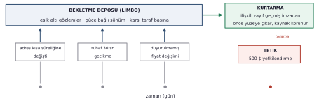
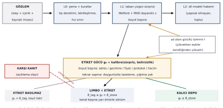
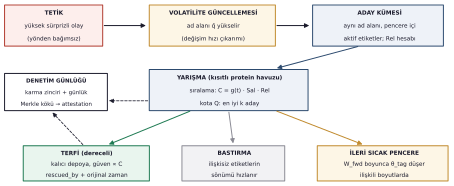
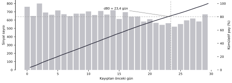

::: abstract
**Özet.** Otonom ajanlar arasındaki ödemeler, karşı tarafın zaman içindeki davranışına dair hiçbir kayıt tutulmadan yetkilendirilmektedir. Mevcut savunma katmanları (harcama kuralları, işlem simülasyonu, küresel tehdit istihbaratı) yalnızca karar anındaki durumu değerlendirir; oysa karşı taraf kaynaklı dolandırıcılığın erken işaretleri, tek tek bakıldığında hiçbir hafıza sisteminin saklama eşiğini geçmeyecek kadar küçüktür ve karar anına gelindiğinde çoktan atılmış olur. Bu makalede NonameTrust'ı (NNT) öneriyoruz: nörobilimde belgelenmiş bir mekanizmayı (synaptic tagging and capture) ajan hafızasına uyarlayan bir karşı taraf hafıza katmanı. Kayıt eşiğinin altında kalan gözlemler süreli bir bekletme deposunda tutulur ve ilişkili önemli bir olay gerçekleştiğinde geriye dönük olarak kalıcı hafızaya alınır; kanıt, büyük bir yetkilendirmenin onu gerektirdiği anda karar katmanının önüne gelir. Filo çapında bir konsolidasyon sinyali aynı mekanizmayı katılımcılar arasına taşır: bir katılımcının doğrulanmış kaybı, diğer bütün katılımcıların taşıdığı ilişkili izleri terfi ettirebilir. Mekanizmanın ön koşulunu Stellar ağının kendi verisi üzerinde sınadık: on yıllık dönemde 76.221 kayıp vakası tespit ettik ve ön-kayıtlı bir protokolle yürüttüğümüz kontrollü geri-testte, kurban cüzdanlarının yüzde 93'ünde kayıptan önceki 30 gün içinde kurtarılabilir öncül sinyal bulunduğunu, eşleştirilmiş kontrol grubunda bu oranın yüzde 47,5'te kaldığını ölçtük. Fark hem istatistiksel hem pratik olarak anlamlıdır; bulgular ayrıca üretim tasarımının iki parametresini (sinyal kanallarının ağırlıklandırılması ve bekletme penceresinin süresi) doğrudan verinin kendisiyle kalibre etmektedir. Uzun vadeli hedef açıktır: ajan sayısı ve yetki tavanları büyüdükçe karşı taraf hafızası, ödeme rayının kendisi kadar temel bir altyapı katmanı haline gelecektir; NNT, bu katmanın referans uygulaması ve açık ölçüm standardı olmak üzere tasarlanmıştır.
:::

## 1. Giriş

Yazılım ekonomisinin yönü bellidir: yapay zeka ajanları yalnızca içerik üreten araçlar olmaktan çıkıp ekonomik aktörlere dönüşmektedir. Kendi cüzdanını tutan, hizmet keşfeden, fiyat karşılaştıran ve ödemeyi insan onayı olmadan yetkilendiren ajanlar bugün deneysel değil operasyoneldir ve bu ekonominin ödeme standardının arkasında sektörün en büyük oyuncuları durmaktadır. Önümüzdeki dönemin belirleyici sorusu ajanların ne kadar akıllı olacağı değil, onlara ne kadar yetki verilebileceğidir: bir ajana tanınan harcama tavanı, sahibinin ona duyduğu güvenin doğrudan fonksiyonudur ve bu güveni bugün taşıyan altyapı katmanı yoktur. Otonominin sınırını zeka değil, güven belirleyecektir. Bu makale o katmanın bir parçasını inşa etmektedir.

x402 ve MPP protokollerinin ana ağda çalışmaya başlamasıyla [10], yazılımın yazılıma ödeme yaptığı bir ekonomi kurulmaktadır: istek başına API ücretleri, akış halinde mikro ödemeler, insan onayı olmadan yürüyen tedarik. Bir ajanın ödeme yaptığı karşı taraf sayısı yüzleri bulur ve bu ilişkilerin hiçbiri tek tek incelenmez. Bu yapının güvenlik varsayımı, her işlemin kendi başına değerlendirilebileceğidir; bu makalenin çıkış noktası, bu varsayımın karşı taraf kaynaklı dolandırıcılık karşısında yapısal olarak yetersiz kaldığıdır.

Karşı taraf dolandırıcılığının bilinen oyun kitaplarından biri güven inşasıdır: küçük ve sorunsuz etkileşimlerle temiz bir geçmiş kurulur, ardından tek büyük taleple vurulur. Diğer kitaplarda ikna büyük ölçüde zincir dışında yürür (sahte vitrin siteleri, mesajlaşma kanalları) ve zincirde yalnızca gölgesi görünür: alışılmadık varlık davetleri, şüpheli memo içerikleri, dolandırıcı hesabın kendine özgü ayak izi. Her iki durumda da kayıptan önceki dönemde erken işaretler ortaya çıkar ve bu işaretlerin her biri, gerçekleştiği anda önemsizdir; incelediğimiz hafıza sistemlerinin hiçbiri bunları saklamaz, çünkü yayınlanmış tasarımlarda bir kaydın önemi yazıldığı anda belirlenir. Karar anı geldiğinde bütün kontroller temiz sonuç verir; önem taşıyan kanıt haftalar önce gürültü olarak atılmıştır. Kayıplar bu modelin marjinal olmadığını göstermektedir: 2025 yılında kripto dolandırıcılığına kaptırılan tutar 17 milyar dolar düzeyindedir [8]; yalnızca ajan altyapısına bağlı olaylar 2026'nın ilk aylarında 45 milyon doları aşmıştır; işlem geçmişini hedef alan address poisoning saldırıları 270 milyon kayıtlı denemeye ulaşmıştır.

Sorunun daha az görünür bir katmanını bu çalışmanın hazırlığı sırasında ölçtük: kanıtın kendisi de kalıcı değildir. Stellar'ın herkese açık Horizon servisi, bu yazının yazıldığı tarihte yalnızca yaklaşık 14 aylık tarihçe sunmaktadır; daha eski defter kayıtları standart uçlardan erişilemez durumdadır. Bir karşı tarafın geçmişindeki uyarı işaretleri yalnızca önemsiz bulunup atılmakla kalmaz; atılmasa bile, ağın resmi erişim penceresi onları zamanla kendiliğinden düşürür. Tam tarihçe arşiv katmanlarında mevcuttur, ancak imza anında karar veren hiçbir sistem oraya bakmaz. Karşı taraf hafızasının ayrı bir bileşen olarak var olması gerektiği iddiasının altında, altyapının bu kendi unutkanlığı da yatmaktadır: kanıt, erişilebilirken damıtılmak zorundadır.

## 2. Mevcut savunma katmanları

Ajan ödemelerini bugün koruyan dört katman vardır ve dördü de ya karar anının fotoğrafını ya da başkalarının deneyimini değerlendirir. Tablo 1 katmanları ve kör noktalarını özetlemektedir.

| Katman | Örnekler | Kör nokta |
|----------------------|----------------------------------|------------------------------------------------------------|
| Statik kurallar | Harcama limitleri, allowlist, session key | Güven kurulumda bir kez verilir; sonradan bozulma görünmez |
| Anlık analiz | İşlem simülasyonu | Bu işlemin şu an ne yapacağını gösterir; geçmiş taşımaz |
| Küresel tehdit istihbaratı | Blocklist taraması, KYT | Bilinen kötüleri tanır; taze adresler temiz görünür |
| Sigorta | İşlem koruması | Kayıptan sonra tazmin eder |
| Birinci elden karşı taraf hafızası | Bu makalenin konusu | Ajanın her karşı tarafla kendi yaşadıklarının boylamsal kaydı |

Table: Tablo 1. Ajan ödeme güvenliğinin bugünkü katmanları.

Ajanlar arası finans üzerine güncel çalışmalar eksik parçayı açıkça adlandırmaktadır: kurumsal ölçekte ajan ödemesi yetki kanıtı, bütçe kanıtı ve karşı taraf kanıtı gerektirir [9]. Bu makalenin kapsamı karşı taraf kaynaklı aldatmadır: güven inşası dolandırıcılığı, davranış kayması ve geçmiş kirletme. Ele geçirilmiş ajan altyapısına yönelik saldırılar kapsam dışındadır; onların çözümü yalıtım ve yetki sınırlamasıdır.

## 3. Biyolojik temel: synaptic tagging and capture

Önerdiğimiz mekanizmanın kaynağı, zayıf anıların kaderine dair bir nörobilim bulgusudur. Frey ve Morris [1], zayıf bir deneyimin sinapslarda kısa ömürlü bir etiket bıraktığını ancak kalıcı kayıt için gereken protein sentezini tetikleyemediğini göstermiştir; iz kendi haline bırakılırsa saatler içinde silinir. Yakın zamanda önemli bir olay yaşanırsa, o olayın saldığı plastisite proteinleri etiketli sinapslar tarafından yakalanır ve silinecek olan zayıf anı geriye dönük olarak kalıcılaşır. İlk çalışma [1] etiketin temel özelliklerini kurmuştur: süreç iki fazlı ve iki eşiklidir; etiket üç saatten kısa yaşar; çok zayıf uyarım hiç etiket basmaz, yani kurtarılabilirliğin bir tabanı vardır; ve yakalama katı biçimde yereldir: aynı dilim içinde mikro kesikle ayrılan deneyde, bir nöron popülasyonunda sentezlenen proteinler komşu ve uyarılmamış popülasyona ulaşmamıştır. Bu ilk çalışmada gösterilen sıra güçlü-önce-zayıf-sonra idi: etiket basıldığında proteinler zaten hazırdı. Devam çalışması [2] ters sırayı, zayıf-önce-güçlü-sonra düzenini kanıtlayarak mekanizmanın simetrisini kurmuştur: önce etiketlenen zayıf deneyim, sonradan gelen önemli olay tarafından kurtarılır; kurtarma bir saate kadar tamdır, iki saatte kısmidir, dört saatte yoktur ve etkinlik arayla monoton azalır. Önerdiğimiz sistemin çalışma yönü tam olarak bu ters sıradır: eşik altı gözlemler önce gelir, onları önemli kılan olay sonra yetişir. Sonraki çalışmalar tabloyu tamamlamıştır: ters yönlü uyarım kurulmuş etiketi sıfırlayabilir [3]; protein havuzu kısıtlıyken etiketli sinapslar bu havuz için yarışır [4]; insan deneyleri etkinin seçici olduğunu, önemli olayın yalnızca kendisiyle ilişkili ve baştan zayıf kodlanmış anıları kurtardığını doğrulamıştır [6]. Bu makalenin üzerine kurulduğu tasarım ilkesini de Frey ve Morris adlandırmıştır: variable persistence [2]; bir kaydın kalıcılığı yazıldığı anda sabitlenmez, sonradan olanlarla revize edilebilir.

Gershman [5], bu parçaları normatif bir çerçevede birleştirir: sinaps gücü, değişen bir ilişkinin olasılıksal tahminidir; protein bulunabilirliği, ortamın çıkarsanan değişim hızının (volatilite) sinyalidir. Önemli bir olay, sistemin volatilite tahminini yükseltir ve bu güncelleme yalnızca gelecekteki öğrenmeyi değil, yakın geçmişteki zayıf kayıtların ağırlığını da geriye dönük değiştirir. Aynı çerçevenin iki öngörüsü tasarımımız için belirleyicidir: gürültülü ortamda mekanizma kısılmalıdır, aksi halde sapmalar gürültüyle karışır; ve etiketle yakalama arasındaki her adım katı eşiklerle değil olasılıksal büyüklüklerle işler. Tablo 2, her biyolojik özelliğin sistemimizdeki karşılığını verir; izleyen iki bölüm bu karşılıkların biçimselleştirilmesini ve mimariyi sunar.

| Biyolojik özellik | Sistemdeki karşılığı |
|----------------------------------------------|----------------------------------------------------------------------|
| İki faz, iki eşik (E-LTP / L-LTP) [1] | θ_tag (bekletme deposuna giriş, düşük) ve θ_store (kalıcı depoya giriş, yüksek) |
| Etiket eşiğinin altında bir taban: çok zayıf uyarım (STP) hiç etiket basmaz [1] | θ_tag altındaki gözlemler gerçekten atılır; bekletme deposunun bir tabanı vardır, her şey girmez |
| Etiketin sinaps özgüllüğü [1] | Etiketler (karşı taraf, boyut) çifti başına basılır: adres bütünlüğü, gecikme, fiyat, protokol, hacim ayrı kanallardır |
| Yakalamanın yerelliği: proteinler yalnızca uyarılan popülasyonda etkilidir [1] | Kurtarma ad alanı kapsamlıdır; tetik yalnızca kendi karşı taraf uzayında, Rel süzgeciyle terfi ettirir |
| Etiket sönümü [1, 2] | Sabit TTL yok; güce bağlı sönüm: zayıf etiket hızlı ölür, güçlü etiket uzun yaşar |
| Kurtarma etkinliği etiket-olay arasıyla monoton azalır [2] | Terfi ikili değil derecelidir: terfi eden kayıt, yakalama skoru C ile orantılı bir güven taşır |
| Farklı zaman seyirli etiket aileleri [2] | Sönüm yarı ömürleri küresel değil kanal başınadır; her sinyal kanalı kendi zamanlama profiliyle kalibre edilir |
| Etiket sıfırlama [3] | Açıklayıcı karşı kanıt, ilgili etiketi iptal eder |
| Yeniden potansiyasyon için mevcut etiketin sıfırlanması gerekir [1] | Aynı (karşı taraf, boyut) çiftinde tekrarlanan sapma etiketi doygunluk altında tazeler; sınırsız yığılma olmaz |
| Kısıtlı protein havuzu [4] | Tetik başına kurtarma kotası; adaylar skorla yarışır |
| Yönden bağımsız yakalama [5, 6] | Tetik tanımı yön gözetmez; olağandışı bir başarı da volatilite tahminini yükseltir |
| Gürültüde kısılma [5] | Karşı taraf başına gürültü tahmini; gürültülü ad alanlarında eşikler kendiliğinden yükselir |
| Etiket basımına hızlı etkili plastisite süreçleri eşlik eder [2] | Aktif etiketin anlık yerel etkisi vardır: karşı tarafının brief çağrı eşiğini düşürür |
| Yaygın, bilgi-fakir sistem konsolidasyon sinyali; yalnızca etiketli sinapslar yanıt verir [2] | Yalnızca küme kimliği taşıyan filo çapında tetik yayını; ilişkili etiket taşıyan ad alanları terfi ettirir, diğerleri yok sayar (Bölüm 5.1) |
| Çevrimdışı konsolidasyon | Okuma imza anında, kalıcılık kararları gece işinde (Bölüm 5) |

Table: Tablo 2. Biyolojik mekanizma ile sistem tasarımı arasındaki eşleme.

## 4. Mekanizmanın biçimselleştirilmesi

İncelediğimiz yayınlanmış hafıza sistemlerinde bir kaydın önemi, yazıldığı andaki içeriğinin ve o kayda yapılan sonraki erişimlerin fonksiyonudur; başka kayıtların başına sonradan gelen olaylar bu önemi değiştiremez ve eşik altı gözlemler hiç saklanmaz. Bunun alternatifini biyoloji adlandırmıştır: variable persistence [2], kaydın kaderi yazıldıktan sonra da revize edilebilir kalır. Yazılım tarafındaki varsayımın (encoding-time-monotonic salience) ilk biçimsel eleştirisi ve STC tarzı kurtarmanın ilk formalizasyonu ise yakın tarihli literatürdedir [7]: etiket sönümü g(t) = g₀ e^(−(t−τ)/T_tag) ve yakalama gücü C = g · Sal(e) · [ω·Rel + (1−ω)] biçiminde tanımlanır ve bir saatlik gecikmede kurtarma oranında 9 katlık artış raporlanır. Ancak biyolojiye sadık saat ölçekli pencereler gün ölçeğinde çöker; Bölüm 8'de gösterdiğimiz gibi, karşı taraf dolandırıcılığının öncül sinyalleri günler ve haftalar ölçeğine yayılmaktadır. Tasarımımız bu nedenle, yazılımın kısıt taşımadığı her noktada biyolojiden bilinçli olarak ayrılır; mantığı proteinlere değil çıkarsamaya dair olan her noktada ise ona bilinçli olarak sadık kalır:

- **Gün ölçekli pencereler.** Bekletme deposunda güce bağlı sönüm, günler ve haftalar mertebesinde yarı ömürlerle çalışır; yazılımın protein sentezi kısıtı yoktur.

- **Kanal başına sönüm sabitleri.** T_tag küresel değil, kanal parametresidir. Biyoloji, farklı zaman seyirli bir etiket ailesine işaret etmektedir [2]; toz izlerinin, memo anomalilerinin ve gecikme sapmalarının aynı hızda yaşlanması için bir neden yoktur ve Bölüm 8'in zamanlama verisi her kanalın yarı ömrü için kalibrasyon girdisidir.

- **İlişkisel kapsam.** Kurtarma taraması karşı taraf uzayında eşleşir: varlık grafiği, gömme (embedding) yakınlığı ve boyut eşleşmesi birlikte kullanılır. Biyolojik karşılığı katı yerelliktir: bir popülasyonda sentezlenen proteinler komşu ve uyarılmamış popülasyona ulaşmaz [1]; tetik hiçbir zaman kendi karşı taraf uzayının dışına terfi ettirmez.

- **Tetik anında bastırma.** Tetik ateşlendiğinde ilişkisiz etiketlerin sönümü hızlanır; sinyal-gürültü oranı iki yönde keskinleşir.

- **Kurtarma kotası.** Tetik başına üst sınır, hafızanın olayla bağıntılı gürültüyle dolmasını engeller.

- **Dereceli terfi.** Biyolojide stabilize olan sinaps oranı, etiket ile olay arasındaki süre uzadıkça azalır [2]; buna uygun olarak terfi eden kayıt, yakalama skoru C ile orantılı bir güven taşır ve brif, terfi etmiş her kaydı eşit saymak yerine bu güvenle ağırlıklandırır.

- **Doygunluk altında etiket tazeleme.** Zaten etiketli bir (karşı taraf, boyut) çiftinde tekrarlanan sapma etiketi yığmaz, tazeler: yeni güç, sönmüş mevcut gücün ve yeni kalibre edilmiş g₀'ın büyük olanıdır; üzerine doygunluğa tabi sınırlı bir artış eklenir. Biyoloji, sinapsın yeniden potansiyasyonu için mevcut etiketin önce sıfırlanmasını gerektirir [1]; yazılımdaki karşılık doygunluktur ve bu aynı zamanda saldırganın tek bir etiketi keyfi güce pompalama yolunu da kapatır.

- **Baştan sona kaynak kaydı.** Kurtarılan kayıt orijinal zaman damgasını ve tetik bağlantısını korur; her karar denetlenebilir bir günlüğe yazılır.

Şekil 1, mekanizmayı bir karşı taraf zaman çizgisi üzerinde uçtan uca göstermektedir.



Etiketin doğru basılması sistemin en duyarlı noktasıdır: yanlış etiket ya gerçek sinyali kaçırır ya da hafızayı gürültüyle doldurur. Bu nedenle salience sabit bir kural değil, karşı tarafın kendi geçmişine göre ölçülen istatistiksel sürprizdir. Her (karşı taraf, boyut) çifti için çevrimiçi bir taban çizgisi tutulur: akan ortalama ve varyans (Welford), dayanıklı sapma ölçüsü (medyan ve MAD), ağır kuyruklu büyüklükler için t-digest yüzdelikleri. Yeni gözlemin sürprizi bu taban çizgisine göre dayanıklı z-skoru olarak hesaplanır; etiket gücü g₀ sürprizin kalibre edilmiş bir fonksiyonudur ve yanında belirsizlik taşınır. Taban çizgisinin kendisi kirlenmeye dayanıklıdır: tek bir gözlemin parametreler üzerindeki etkisi sınırlıdır ve hızlı tahminci, yavaş güncellenen bir referansla birlikte okunur; varyansı şişirmeye çalışan bir saldırgan bunu, iki zaman ölçeği arasındaki açılmanın girişimi ele vermesinden daha hızlı yapamaz. Az veri görmüş karşı taraflarda süreklilik gösteren büyüklükler için asgari gözlem sayısına ulaşılana kadar etiket üretilmez ve taban çizgisi, filo genelindeki önsel dağılıma doğru çekilir; kategorik olaylar (adres değişikliği, yetki talebi, benzer adres tespiti) ise taban çizgisinden bağımsızdır ve ilk günden etiketlenir. Gershman'ın gürültü uyarısı doğrudan uygulanır: bir ad alanının gözlenen gürültü düzeyi yüksekse θ_tag kendiliğinden yükselir; böylece istikrarsız bir servisin her hıçkırığı etiket basmaz. Yapısal olmayan içerik, toplu çalışan küçük bir dil modeli tarafından yalnızca belirsiz durumlarda puanlanır. Kesinlik ve duyarlılık bilinçli olarak asimetrik dağıtılır: bekletme deposuna giriş ucuz olduğundan kaçırmamak esastır; kalıcı depoya giriş ve karar katmanına çıkış, yanlış alarm bütçesine tabidir. Şekil 2 etiketleme hattını uçtan uca göstermektedir.



## 5. Sistem mimarisi

NNT, okuma ile kalıcılaştırmayı ayıran iki yollu bir mimariyle çalışır. Bu ayrım, tasarımın uçtan uca simülasyonunda ortaya çıkan bir gereklilikti: kurtarma yalnızca çevrimdışı bir işte koşarsa kanıt karar anına yetişmez. Senkron yolda, ajan yüksek riskli bir niyetle brief çağrısı yaptığında sistem o karşı tarafın aktif etiketlerini ve kalıcı kayıtlarını anında okur, ilişkililiği önceden hesaplanmış yapılarla değerlendirir ve kanıtı gerekçeli, dereceli bir brife çevirir; hedef gecikme 1-2 saniyedir ve çağrı yalnızca eşik üstü niyetlerde yapılır. Asenkron yolda, günün doğrulanmış tetikleri işlenir: volatilite tahminleri güncellenir, kurtarma yarışması koşulur, kazananlar kalıcı depoya terfi eder, ilişkisiz etiketler bastırılır ve denetim günlüğü zincirlenir. İki yol, ayrı adları hak eden iki mekanizmayı gerçekler. Senkron geriye dönük hatırlama brief'in yaptığıdır: etiketler bekletme deposunda henüz canlıyken, mevcut niyet onları bu tek karar için yeniden okur ve yeniden tartar. Asenkron yakalama ise gece işinin yaptığıdır: bu gözlemlerden hangilerinin sınırlı pencereyi aşıp yaşayacağına karar verir. Hatırlama mevcut yetkilendirmeye, yakalama ondan sonraki bütün yetkilendirmelere hizmet eder; bu ayrım doğal bir sorunun da cevabıdır: brief zaten canlı bekletme deposunu tarıyorsa yakalamanın katkısı nedir? Mevcut karar için hiçbir şey; pencere geçtikten sonraki kararlar için her şey, çünkü terfi olmadan aynı karşı taraf aylar sonra boş bir dosyaya döner, terfi eden kayıt ise kalıcıdır ve sicili hazır bekler. Volatilite tahmini q̂ skorlamanın gerçek bir girdisidir: yakalama eşiği q̂ ile ters orantılıdır, yakalama skoru C = g(t) · Sal(e) · Rel · vol(q̂) çarpanını içerir ve ileri dönük sıcak pencerenin süresi q̂ ile ölçeklenir. Etiketler kurtarmadan önce de iş görür: etiket basımının anlık ve yerel bir etkisi vardır; aktif etiket taşıyan karşı tarafın brief çağrı eşiği düşer ve bir sonraki niyeti, hesap genelindeki varsayılandan daha küçük bir tutarda brif tetikler. Biyolojik paralel doğrudandır: etiket basımına, anlık sinaptik etkileri olan hızlı plastisite süreçleri eşlik eder [2]. Hafıza servisi imza anında erişilemezse başarısızlık politikası tek bir varsayılana değil, niyetin risk katmanına bağlıdır: düşük riskli niyetler hafızasız devam eder ve durum günlüklenir, çünkü gündelik ödemeleri kilitleyebilen bir hafıza katmanı kabul edilemez; orta katman geçici bir tutar tavanı altında devam eder; yüksek riskli niyetler ise insan onayı için bekletilir, çünkü saldırgan, katmanın erişilebilirliğini bozarak onu atlayamamalıdır.

Ad alanlarının altındaki kimlik modeli bilinçli olarak mütevazıdır. NNT evrensel varlık çözümlemesi (entity resolution) iddiasında değildir: bir ad alanı, entegre eden ödeme veya servis katmanının verdiği karşı taraf kimliğine çapalanır; bu kimlik bir x402 ödeme uç noktası, bir servis domaini, bir satıcı kimliği veya daha zengini yoksa yalnızca bir cüzdan adresidir. Adresler, domainler ve uç noktalar ad alanının kendisi değil, öznitelikleridir. Entegrasyon süreklilik sağlıyorsa adres rotasyonu, mevcut bir karşı taraf hakkında bir gözlem olarak gelir; Bölüm 9'daki senaryo bunu tam böyle okur. Süreklilik verilmemişse yeni adres, Bölüm 4'ün soğuk başlangıç önseliyle yeni bir ad alanı açar. Süreklilik bir entegrasyon beyanıdır ve kaynak kaydı olarak tutulur; NNT kimlikleri kendi başına asla çıkarsamaz veya sessizce birleştirmez. Bu modelin iddia etmediği şey kimlik katmanında Sybil direncidir: kurban başına taze cüzdan yakan bir operasyon, birinci elden geçmişi tanım gereği boşa düşürür; o durumu, cüzdanı değil operasyonu izleyen küme-çapalı kanallar ile Bölüm 5.1'in filo konsolidasyonu taşır. Şekil 3 kurtarma akışını, aşağıdaki sözde kod iki yolun işleyişini özetler.



```python
def brief_threshold(ns):                    # FAPP analogu: canli etiket esigi dusurur
    return TH_INTENT * (FAPP_FACTOR if limbo.has_active(ns) else 1.0)

def brief(ns, intent):                     # imza ani: senkron yol
    trg = as_candidate_trigger(ns, intent)
    ev = limbo.active(ns) + permanent.recent(ns)
    ev = [t for t in ev if rel(t,trg) >= RHO and g(t,now)*rel(t,trg) >= TH_BRIEF]
    note_trigger(trg)
    return synthesize(ev, intent)          # kanit -> gerekceli, dereceli brif

def nightly_consolidation(day):             # gece: kalicilashtirma
    for trg in verified_triggers(day) + fleet_inbox(day):     # yayinlar kuyruga katilir
        ns = trg.namespace_scope
        q[ns] = mean_revert(update_volatility(q[ns], trg.surprise))
        cand = [t for t in limbo.active(ns) if within_window(t, trg)]
        for t in cand: t.C = g(t,now,T_tag[t.channel]) * sal(trg) * rel(t,trg) * vol_boost(q[ns])
        th = TH_CAPTURE / (1 + K_VOL * q[ns])
        winners = top_k([t for t in cand if t.C >= th], key=C, k=QUOTA(trg))
        promote(winners, rescued_by=trg, conf=lambda t: t.C) # dereceli; orijinal zaman korunur
        suppress([t for t in cand if rel(t,trg) < RHO_UNREL])
        open_hot_window(ns, W_FWD * vol_factor(q[ns]))
        audit.chain(trg, winners)
    for trg in verified_triggers(day):
        if trg.harm_confirmed:                                 # yalniz katman A/B kaniti
            fleet.publish(cluster_id(trg), sal(trg))           # kimlik + onem, baska hicbir sey
    limbo.expire_decayed(now); anchor_merkle_root(audit.day_root(day))
```

Sözde kod üç tetik derecesini ayırır ve bu ayrım yük taşır. Aday tetik, karar anında gözlenen belirgin niyettir; brif açar ve not edilir, ancak henüz bir sonucu olmadığından hiçbir şeyi terfi ettirmez. Doğrulanmış tetik, sonucunu sistemin kendisinin gözlemlediği ve bütünlük denetiminden geçirdiği olaydır; yönden bağımsızdır, olağandışı büyüklükte tamamlanmış bir settlement da bir başarısızlık kadar sayılır; volatilite güncellemelerini ve gece yarışmasını doğrulanmış tetikler sürer. Zararı doğrulanmış tetik ise olumsuz sonucu ek olarak bir kanıt katmanını karşılayan doğrulanmış tetiktir: Katman A, zincir üstünde nesnel olarak doğrulanabilir olumsuz sonuç, protokolün dayattığı bir başarısızlık veya imzalı koşulların kanıtlanabilir ihlali; bir transferin salt varlığı yetmez. Katman B, güvenilir dizin veya sağlayıcı onayı; Katman C, kiracının beyan ettiği zarar. Filo yayın hakkını yalnızca A ve B katmanları taşır. Katman C raporu, raporlayanın kendi ad alanında sıradan bir yerel tetik gibi işler ve o alanın dışına asla çıkmaz; kötü niyetli bir kiracının iddiası kendi deposunun ötesinde hiçbir şeyi büyütemez.

### 5.1 Filo çapında konsolidasyon

Biyolojinin çok kiracılı bir sistem için en önemli ipucu, beynin yapılar arasında nasıl konsolide ettiğindedir. Frey ve Morris, hipokampusun kortekse gönderdiği konsolidasyon sinyalinin yaygın ve bilgi-fakir olabileceğini öne sürer: geniş bir nöron popülasyonuna yayınlanan, plastisite proteinleri sentezleme talimatı; seçicilik tamamen alıcı uçtadır, sinapsların çoğunda etiket olmadığından hiçbir şey olmaz, etiketli sinapslardaki geçici değişimler ise stabilize edilir [2]. NNT aynı iş bölümünü müşteri ad alanları arasında uygular. Bir tetiğin zararı A veya B katmanında doğrulandığında (bir katılımcının kanıtlanmış kaybı veya bir operasyon kümesine yeni düşen dizin etiketi) platform, yalnızca küme kimliği ve önem derecesi taşıyan filo çapında bir konsolidasyon yayını çıkarır: kurban kimliği yok, tutar yok, içerik yok. Her ad alanı bu yayını sıradan türden bir dış tetik gibi işler: yerel bekletme deposu o kümeyle ilişkili etiketler taşıyorsa (kümenin bir adım komşuluğundan toz, memo deseni, benzer adres yakınlığı), bu etiketler aynı kota altında aynı yakalama yarışmasına girer; ilişkili etiket taşımayan ad alanları yayını tümüyle yok sayar ve hiçbir şey yazılmaz. Yayının bilinçli olarak bilgi-fakir tutulması, biyolojik sinyalin bunu göze alabilmesiyle aynı nedene dayanır: seçiciliğin tamamı yereldir. Ölçülen dolandırıcılık manzarası değeri somutlaştırmaktadır. Geri-test verisinde baskın olan tek vuruşluk operasyonlar, bir sonraki kurbanlarıyla güven inşası geçmişi bırakmaz; ama küme izlerini (toz, memo, varlık daveti) aynı anda birçok bekletme deposunda bırakır. Bir katılımcının doğrulanmış kaybı, operasyon bir sonraki hedefine ulaşmadan ve herhangi bir topluluk etiketi doğmadan önce, bu izleri filo çapında terfi ettirir. Koruma katılımla birleşik büyür ve bu büyüme kurban kimliği, tutar veya ham gözlem paylaşmaz. Ad alanları arasında geçen tek şey üstveridir: bir küme yayınının varlığı ve zamanlaması; gece toplu gönderim ritmi bu korelasyon kanalını da köreltir. Filo beyanları sürümlüdür ve geri çekilebilir: her yayın imzalı kaynak kaydı taşır; imzalı bir geri çekme veya düzeltme, terfi etmiş kayıtları silmez ama güvenlerini düşürür ve rescued_by soyağacı, geri çekilen yayının tam olarak hangi terfileri etkilediğini gösterir; bunların tamamı diğer her karar gibi denetim günlüğüne zincirlenir. Gönderim ritminin kendisi ilan edilmiş bir ödünleşimdir: toplu gönderim mahremiyeti saatler mertebesinde gecikme pahasına satın alır; kaynağı zaten kamuya açık olan yayınların (bir dizin etiketi) toplu gönderimi beklemesi gerekmez. Şekil 4 akışı göstermektedir.

![Şekil 4. Filo çapında konsolidasyon. Doğrulanmış tetik yalnızca küme kimliği ve önem derecesi yayınlar; neyin terfi edeceğine her ad alanının kendi etiketleri yerel olarak karar verir. İlişkili etiket taşımayan ad alanları yayını yok sayar; bu, biyolojinin yaygın konsolidasyon sinyalinin birebir karşılığıdır [2].](figures/fig4-tr.svg)

## 6. Bütünlük ve doğrulanabilirlik

İmza öncesi kararları etkileyen bir sistemin kayıtları kurcalanabilir olursa sistemin kendisi saldırı yüzeyine dönüşür. Dört katman uygulanır. Birincisi, olay kaynaklı veri modeli: gözlemler değişmezdir; her karar (etiket, terfi, bastırma, düşüm) gözlemlerden türetilir ve politika sürümüyle birlikte kaydedilir, böylece herhangi bir politika sürümü geçmiş üzerinde deterministik olarak yeniden koşturulabilir. İkincisi, karma zincirli denetim günlüğü: her kayıt bir önceki kaydın SHA-256 özetini içerir ve günlük HMAC ile imzalanır; tek bir satırın değişmesi zincirin kalanını geçersiz kılar ve HMAC simetrik olduğundan sağladığı güvence iç bütünlüktür, bağımsız doğrulanabilirlik bir sonraki katmandan gelir. Üçüncüsü, günlük Merkle kökünün zincir üstü bir attestation kontratına yazılması: veri gizli kalır, ancak herhangi bir müşteri kendi kayıtlarının o günkü köke dahil olduğunu Merkle kanıtıyla bağımsız doğrulayabilir. Güvence tam olarak adlandırılmalıdır: çapalama, geçmişi kurcalama-kanıtlı (tamper-evident) kılar; bir günün kökü zincire yazıldıktan sonra işletmeci dahil hiç kimse o kökün kapsadığını sessizce değiştiremez. Çapalama, bir gözlemin ilk yazıldığında doğru olduğunu ise kanıtlamaz; alımın imzalı kaynaklarla ve yeniden koşturulabilir politika sürümleriyle ayrıca kısıtlanmasının nedeni budur. Dördüncüsü, beklemedeki verinin şifrelenmesi: gözlem içerikleri AES-256-GCM ile, karşı taraf uzayı başına ayrı anahtarla saklanır; karar katmanına ham içerik değil türetilmiş özellikler iletilir. Silme ile kurcalama-kanıtlılık tasarım gereği bir arada yaşar: zincir ve çapalanan kökler düz metne değil şifreli içeriğin özetlerine bağlanır; bir ad alanının anahtarlarının imhası içerikleri geri döndürülemez biçimde erişilmez kılar (crypto-shredding), daha önce çapalanmış her kök ise doğrulanabilir kalır. Bölüm 5.1'in filo yayını da aynı disipline tabidir: yayımlanan küme kimlikleri zincirlenir ve attest edilir; böylece bir katılımcı, üzerine işlem yaptığı yayının gerçek olduğunu ve iddia edilen anda yayımlandığını doğrulayabilir.

## 7. Hafızayı hedef alan saldırılar

Savunma katmanı haline gelen her bileşen, saldırının da hedefi olur. Altı saldırı sınıfını ve karşılıklarını ele alıyoruz. Gürültüyle boğma girişiminde saldırgan, çok sayıda zararsız gözlem üreterek gerçek sinyali kota yarışında ezmeye çalışır; kaynak başına hız sınırı, içerik tekilleştirme, boyut başına ayrı kota ve imzasız gözlemin hiç alınmaması bu yolu kapatır; ayrıca her gözlemin taban çizgisi üzerindeki etkisi sınırlı olduğundan (Bölüm 4), boğma girişimi saldırgana daha geniş bir taban çizgisi de satın alamaz. Taban çizgisi zehirlemesinde davranış çok yavaş kaydırılarak her adım eşik altında tutulmaya çalışılır; taban çizgisi güncellemesi kasıtlı olarak yavaştır ve her gözlemin etkisi sınırlıdır; hızlı bir tahminci, yavaş güncellenen bir referansla birlikte okunur, böylece varyans şişirme sürüklenmeyi süresiz normalleştiremez ve iki zaman ölçeği arasındaki açılma kendisi etiketlenen bir anomalidir; kategorik olaylar taban çizgisinden bağımsız her zaman etiketlenir. Pencere oyununda saldırgan bekletme sürelerini bilerek sinyalleri pencere dışına zamanlamayı dener; pencere uzunluklarına deterministik tohumlu küçük bir sapma eklenir ve asıl güvence güce bağlı sönümdür: gerçekten anormal olay güçlü etiket alır ve uzun yaşar; istatistik, gizliliğin koruyamadığı yerde korur. Doygunluk, bitişik yolu da kapatır: tekrarlanan sapma etiketi yığmak yerine tazelediğinden (Bölüm 4), saldırgan seçtiği bir etiketi yarışmayı ezecek keyfi güce pompalayamaz. Bastırma istismarında sahte tetiklerle gerçek etiketlerin bastırılması umulur; bastırma yalnızca doğrulanmış tetiklerde ve yalnızca düşük ilişkili etiketlere uygulanır, silme değildir ve denetim günlüğünde izlenebilir kalır. Karşı kanıt zehirlemesinde, etiketi tetiklemiş bir saldırgan zararsız görünen açıklamalar sahneleyerek etiketi temizletmeyi dener. Karşılık katı bir kaynak kuralıdır: karşı kanıt hiçbir zaman bir beyan değildir ve karşı tarafın kendi açıklaması hiçbir ağırlık taşımaz; etiket yalnızca sistemin kendisinin gözlemlediği doğrulanabilir olaylarla sıfırlanır (etiketlenen sapmayı çürüten tamamlanmış bir settlement veya sahibin açık onayı gibi), kategorik etiketlerde sıfırlama mutlak değil derecelidir ve her sıfırlama diğer bütün kararlar gibi denetim günlüğüne zincirlenir. Son olarak yayın istismarı filo katmanını hedefler: sahte veya taklit bir konsolidasyon yayını, filo çapında terfileri zorlamayı deneyebilir. Bu nedenle yayınlar yalnızca zararı doğrulanmış tetikler için çıkarılır, diğer her karar gibi imzalanıp attest edilir (Bölüm 6), küme başına hız sınırına tabidir ve silah olarak yapısal biçimde zayıftır: yayın kendi başına hiçbir şeyi terfi ettirmez; terfi, alıcı ad alanının zaten ilişkili etiket taşımasını ve bu etiketlerin aynı yarışma ile kotadan geçmesini gerektirir.

## 8. Ampirik doğrulama: Stellar üzerinde kontrollü geri-test

Mekanizmanın değeri bir ön koşula bağlıdır: kayıptan önce, kurtarılmaya değer öncül sinyal gerçekten var mıdır ve sıradan cüzdan trafiğinden ayırt edilebilir midir? Bu soruyu, sistemin hiçbir bileşenini kurmadan, Stellar ağının halka açık verisi üzerinde kontrollü bir geri-testle sınadık. Bu bölüm yöntemi ve sonuçları raporlamaktadır; yöntem, sonuçlar görülmeden önce yazılı olarak sabitlenmiştir.

### 8.1 Yöntem

Vaka evreni, topluluk kaynaklı explorer etiketleriyle işaretlenmiş 16.837 dolandırıcı adresten kuruldu. Kayıp olayı, işaretli bir adrese yapılan tek seferlik 200 XLM ve üzeri ödeme veya göndericinin kendi 90 günlük ödeme dağılımının 90. yüzdeliğini aşan ödeme olarak tanımlandı; muhtemel saklama hizmeti hesapları hacim tavanıyla elendi. Tam ifadeyle her vaka, topluluk-işaretli bir karşı tarafa yapılmış nitelikli bir transferdir; dizinin etiketleri topluluk kaynaklıdır ve yer yer eksik veya tarihsizdir, dolayısıyla kayıp burada ölçülen bir vekildir (proxy) ve terim bu makale boyunca bu anlamda kullanılmaktadır. Tam sayım, arşiv veri kümesi (Hubble/BigQuery) üzerinde SQL ile yapıldı ve on yıllık dönemde (Aralık 2016 - Ağustos 2026) 27.524 farklı kurbana ait 76.221 kayıp vakası tespit edildi; vakalar 1.872 dolandırıcılık operasyonunda kümelenmektedir. Medyan kayıp 250 XLM'dir ve vakaların yüzde 70'i mutlak eşik dalından gelmektedir; SQL çevirisinin doğruluğu, pilot aşamasında Horizon API'siyle bağımsız olarak bulunmuş 20 vakanın tamamının birebir yeniden üretilmesiyle doğrulandı; bu doğrulama sırasında Horizon'un yaklaşık 14 aylık erişim penceresi de ölçülmüş oldu.

Sinyal katalogu taramadan önce donduruldu ve altı kanaldan oluşur: ilişkili adres kümesinden toz transferleri (S1), kurbandan dolandırıcıya kayıp öncesi küçük deneme ödemeleri (S2), karşı taraf hesabının gençliği veya davranış kırılması (S3), kurbanın sık kullandığı adreslere benzeyen adreslerden temas (S4), bilinmeyen ihraççıdan varlık daveti (S5) ve şüpheli memo içeriği (S6). Analiz örneklemi, tüm sinyallerin tam ölçülebildiği dilimden (kayıp tarihi arşiv ve erişim pencerelerinin tamamen içinde kalan, 113 operasyona yayılı 2.381 vaka) tabakalı olarak seçilen 100 vakadır; seçim, operasyon başına küme tavanı, iki eşik dalından orantılı pay ve zaman yayılımı kısıtlarıyla, tohumlu ve yeniden üretilebilir biçimde yapılmıştır. Her kurban için, hesap yaşı, işlem hacmi ve aynı dönem aktifliği üzerinden eşleştirilmiş, işaretli hiçbir adrese ödeme göndermemiş iki kontrol cüzdanı seçildi (toplam 200). Kontrol örnekleme çerçevesinin uzunluk yanlılığı pilotta tespit edilmiş ve tabakalı SQL çerçevesiyle giderilmiştir. Seçilen 100 vakanın kayıp dağılımı popülasyondan daha küçük tutarlara kaymıştır: en küçük 5, medyan 50, doksanıncı yüzdelik 300, en büyük 88.436 XLM; 20 vaka mutlak eşikten, 80 vaka göreli daldan nitelenmiştir. Başarı ölçütleri, altı kriterlik bir tablo halinde taramadan önce kayıt altına alındı; birincil çıkarım, kurbanların operasyonlarda kümelenmesini hesaba katan küme-dayanıklı önyükleme (bootstrap) ile yapıldı. Boru hattının tamamı, dondurulmuş belgeler, testler ve toplulaştırılmış sonuç dosyaları, çalışmanın yeniden üretilebilmesi için herkese açık bir depoda yayımlanmıştır [11].

### 8.2 Sonuçlar

Kurban cüzdanlarının yüzde 93'ünde, kayıptan önceki 30 gün içinde dondurulmuş katalogdan en az bir sinyal bulundu; eşleştirilmiş kontrol grubunda bu oran yüzde 47,5'tir. Fark 45,5 puandır; göreli risk 1,96 (yüzde 95 güven aralığı 1,71-2,26) ve küme-dayanıklı sınamada p < 0,05'tir. Fark, tek bir kanala bağımlı değildir: küme-dayanıklı sınamada dört kanal farkı bağımsız taşımaktadır (S1 +13,5; S2 +14,0; S5 +40,5; S6 +27,5 puan). Hedefli kanallar tek başına ayırt edicidir: kayıp öncesi küçük deneme ödemesi (S2) kurbanların yüzde 14'ünde görülürken 200 kontrolün hiçbirinde görülmemiştir; ilişkili kümeden toz transferi (S1) kurbanlarda yüzde 17, kontrollerde yüzde 3,5'tir; benzer adres kanalı (S4) anlamlı fark üretmemiştir. S2 için bir okuma disiplini geçerlidir: kontroller tanım gereği işaretli hiçbir adrese ödeme göndermemiş cüzdanlar olduğundan S2'nin kontrollerde sıfır çıkması ölçülmüş değil yapısaldır; bilgilendirici sayı, kurban tarafındaki hedefe özgü öncülün yüzde 14'lük yaygınlığıdır. Benzer bir disiplin S1 için de geçerlidir: operasyonun bir adımlık kümesi, dolandırıcı hesabın ödeme grafiğinden tarama anındaki haliyle kurulmuştur ve dizin etiket tarihi vermediğinden küme üyeliği geriye dönük bilgi taşır; aynı küme kurbanlara ve kontrollere simetrik uygulandığı için karşılaştırma adil kalır, ancak S1'in ölçtüğü şey geriye dönük kanıt mevcudiyetidir, kümenin karar anında kurulabileceği değildir; onu tam olarak Bölüm 9'un gölge değerlendirmesi ölçecektir. Manşet bu tek kanala yaslanmamaktadır ve bunu yayımlanmış marjinal oranlar tek başına kanıtlar: bir kanalı çıkarmak birleşik oranı yalnızca düşürebilir ve istenmeyen varlık davetleri (S5) tek başına kurbanların yüzde 87'sine ulaştığından, S1 hariç birleşik sinyal oranı kurbanlarda yüzde 87 ile 93 arasında, kontrollerde yüzde 46,5 ile 47,5 arasında sınırlıdır; kesin tek-kanal-hariç oran, yayımlanmış boru hattından yeniden üretilebilir. Kontrol grubundaki yüksek taban oranının kaynağı ise hedefli kanallar değil, ortam kanallarıdır: istenmeyen varlık davetleri kontrollerin yüzde 46,5'inde, şüpheli memo içeriği yüzde 41,5'inde mevcuttur. Zamanlama açısından sinyaller 30 günlük pencereye yayılmaktadır; isabetlerin yüzde 80'i kayıptan önceki 23,4 gün içindedir ve ön-kayıtlı 14 günlük bekletme bandı payı yüzde 70 eşiğinin altında kalmıştır.

Sonuç, pencere seçimine dayanıklıdır: aynı karşılaştırma 7 günlük pencerede yüzde 88'e yüzde 41, 14 günlük pencerede yüzde 92'ye yüzde 43 vermektedir. Sinyallerin zamana dağılımı Şekil 6'da verilmiştir: isabetler 30 günlük pencereye yaklaşık tekdüze yayılmakta, son 24 saate yığılma göstermemektedir; bu, anlık analizin bu sinyalleri yakalayamayacağını ve bekletme mekanizmasının gerekliliğini doğrulamakta, ancak dağılımın uzunluğu ön-kayıtlı 14 günlük bandı aşmaktadır.




Ön-kayıtlı altı kriterin dördü sağlanmıştır: küme-dayanıklı anlamlılık, etki büyüklüğü, birden fazla bağımsız taşıyıcı kanal ve pencere seçimine dayanıklılık. İki kriter sağlanmamıştır: kontrol taban oranı hedeflenen yüzde 40'ın üzerindedir ve zamanlama dağılımı ön-kayıtlı bekletme bandından uzundur. Dondurulmuş karar tablosuna göre sonuç, güçlü doğrulama değil ölçülmüş işaret satırına düşmektedir ve bu makale boyunca kullanılan dil buna göre seçilmiştir: öncül sinyalin varlığı ve ayırt ediciliği ölçülmüştür; bu kayıpların önlenebileceği iddia edilmemektedir.

### 8.3 Bulguların tasarıma etkisi

Sağlanmayan iki kriter, hipotezin çürümesi değil, üretim parametrelerinin verinin kendisiyle kalibrasyonudur. Birincisi, kanallar eşit ağırlıkla birleştirilemez: ortam kanalları (S5, S6) ağ genelinde yaygın gürültüdür ve tek başlarına karar taşıyamaz; ikili varlık yerine yoğunluk, yenilik ve karşı tarafın kendi taban çizgisinden sapma gibi sürekli özelliklerle skorlanmaları gerekir. Farkı bağımsız taşıyan dört kanal S1, S2, S5 ve S6'dır; benzer adres kanalı (S4) bu örneklemde anlamlı fark üretmemiştir (+2,5 puan, güven aralığı sıfırı kapsar) ve Stellar bağlamında bir bulgu olarak değil, düşük maliyetli bir ihtiyat kanalı olarak konumlanır. Bu tablo, Bölüm 4'te tanımlanan gürültü-uyarlanır eşiklerin ve kanal ağırlıklandırmasının sahadan doğrulamasıdır; kanal birleşimi üretimde öğrenilmiş ağırlıklarla yapılmalıdır. İkincisi, gözlenen zamanlama dağılımı bekletme penceresinin 7-14 günlük varsayımdan uzun kurulması gerektiğini göstermektedir: birincil pencerede d80 = 23,4 gündür (isabetlerin yüzde 80'inin içinde kaldığı mesafe) ve bu değer, taramanın kendi 30 günlük tavanıyla sansürlü bir alt sınırdır (bkz. 8.4); bulgu, saat ölçekli pencerelerin yetersizliğine dair Bölüm 4'teki savı güçlendirmekte ve gün ölçeğinin de veriyle ayarlanması gerektiğini ortaya koymaktadır. Aynı taramadan çıkarılacak bir kalibrasyon girdisi daha vardır: burada raporlanan zamanlama dağılımları bütün kanalları havuzlamaktadır, oysa Bölüm 4'ün sönüm sabitleri kanal başına tanımlıdır; yayımlanan ham isabet verisi kanal başına mesafe profillerini desteklemektedir ve her kanalın yarı ömrünü kendi profilinden öğrenmek, belirlenmiş bir sonraki analizdir. Örneklemin sınırları açıkça belirtilmelidir: analiz dilimi on yıllık bir olgunun yaklaşık son on ayını temsil etmektedir, kayıplar görece küçük tutarlıdır ve bulguların büyük tutarlı kayıplara genellenebilirliği açık bir varsayımdır; arşiv verisi üzerinde kısmi sinyal setiyle yürütülen genellenebilirlik eki ön-kayıtlıdır ve sonuçları 8.4'te ayrı olarak raporlanmaktadır.

### 8.4 Genellenebilirlik eki (Tasarım B) ve keşifsel zamanlama ölçümü

Ön-kayıtlı B eki, birincil analizle karşılaştırılamaz ve hiçbir tabloda onunla birleştirilmez: farklı bir alet (arşiv verisi üzerinde SQL; Horizon değil), kısıtlı bir sinyal seti (S2, S3, S4, S6; S1 ve S5 bu alette tasarım gereği ölçülemez ve hiçbir zaman yanlış sayılmaz) ve farklı bir dönem (Ekim 2017 - Ağustos 2025; birincil analizin erişemediği eski nüfus, 2022-2023 zirve yılları dahil). Aynı seçim gramerine göre kurulan 100 vaka ve 200 eşleştirilmiş kontrolde (60 operasyon), B'nin birleşik sinyal oranı kurbanlarda yüzde 70,0, kontrollerde yüzde 15,0'dır (küme-dayanıklı fark +55,0 puan, yüzde 95 GA [+42,6, +66,3], p=0,001); sonuç üç pencerede de ayaktadır. Düşük kontrol tabanı dönemin temizliği olarak OKUNMAMALIDIR: birincil analizde kontrol tabanını yükselten iki ortam kanalı (S1, S5) bu alette hiç ölçülmemektedir. Ekin sorusu nicel değil nitelikseldir: eski dönem farklı bir şekil mi çiziyor? Cevap hayırdır ve en özgül bulgu aynen tekrarlamaktadır: kayıp öncesi deneme ödemesi (S2) eski dönemde de yalnızca kurbanlarda vardır (yüzde 10,0'a karşı yüzde 0,0; birincil analizde yüzde 14,0'a karşı yüzde 0,0). İki bağımsız alet, iki farklı dönem, aynı imza. Benzer adres kanalı (S4) her iki dönemde de ihmal edilebilir düzeydedir ve hiçbir karşılaştırmayı taşımamaktadır; memo kanalı (S6) her iki dönemde de ayrışmaktadır (yüzde 38,0'a karşı yüzde 15,0). Aletler arası tutarlılık, taramadan önce birincil örneklemin 100 kurbanı üzerinde doğrulanmıştır: S2, S4 ve S6 için yüzde 100 uyum; S3 için ham uyum yüzde 84 olup 16 uyuşmazlığın 15'i, birincil aletin metodolojide önceden belgelenmiş kayıt-tavanı yanlılığına birebir izlenmiş ve düzeltilmiş uyum 99/100 olarak kayda geçmiştir; ön-kayıtlı parite kapısı bu farkı otomatik durdurmayla yakalamıştır. Şeffaflık notu: S3 parite teşhisi, maliyet kısıtı nedeniyle sonradan sadeleştirilen ekstraksiyonun sadeleştirme öncesi halini ölçmüştür; sevk edilen alet için yüzde 84 bir üst sınırdır ve etkisi sınırlıdır, çünkü B'nin 45 S3 isabetinin 40'ı sadeleştirmeden etkilenmeyen yaş dalından gelmektedir.

Ekin bir diğer çıktısı, dondurulmuş katalogun dışında ve keşifsel olarak etiketlenmiş zamanlama ölçümüdür. Birincil analizin d80 = 23,4 günlük değeri, taramanın yalnızca 30 günlük pencereyi çekmesiyle sansürlüdür; B'nin aleti pencere tavanı taşımadığından aynı dağılım 90 günlük pencerede ölçülebilmiştir. Günlük yoğunluk profili iki bileşen göstermektedir (Şekil 7): sinyaller kayba yaklaştıkça belirgin biçimde yoğunlaşmaktadır (kayıptan önceki ilk haftada günlük isabet yoğunluğu, uzak kuyruğun yaklaşık üç katıdır) ve bunun ötesinde, 90 günlük pencere boyunca hatırı sayılır ve yaklaşık düz bir sinyal kuyruğu uzanmaktadır. Bu profilden kesin bir öncül süresi türetilmemelidir: yüzdelik mesafeler pencere genişledikçe mekanik olarak büyür ve 90 günlük görüşte kontrol kolu bulunmadığından ortam gürültüsünün payı netleştirilemez; kesin bir bekletme süresi önerisi, kontrollü uzun pencere ölçümü gerektirir. Yine de iki sonuç nettir: 7-14 günlük bekletme varsayımı veriyle desteklenmemektedir ve uzun kuyruk, Bölüm 4'te tanımlanan güce bağlı sönüm ile kalıcılaştırma bacağının değerini artırmaktadır: sinyaller uçucu bir pencereye sığmamakta, terfi eden kayıtları uzun süre taşıyan kalıcı bir katman gerektirmektedir. Sınırlı bekletme penceresinin kendisinin de ilkesel bir okuması vardır, yalnızca ekonomik değil. Frey ve Morris, uzun ömürlü etiketlerin birbirinden bağımsız bağlamlardaki olayları karşılıklı stabilize etmesine yol açacağını ve istenmeyen bu girişimi sınırlayan şeyin tam olarak etiket-protein etkileşiminin kısıtlı zaman seyri olduğunu not eder [2]. Şekil 7'deki düz uzak kuyruk, bir bölümü hiçbir kontrol kolunun netleştiremediği ortam gürültüsü olmak üzere, aynı riskin ampirik yüzüdür: pencereyi genişletmek, yanlış kurtarma riskini en az sinyal kadar hızlı büyütür; bu tasarımda uzun hafızaya pencereyi uzatarak değil, yarışma altında terfi ile ulaşılmasının nedeni budur.


## 9. Ürün: Stellar üzerinde referans uygulama

NNT referans uygulamasının Stellar üzerinde kurulmasının üç gerekçesi vardır. Birincisi, ajan ödeme rayları burada canlıdır: x402 ve MPP ana ağda çalışmaktadır ve ekosistemin güncel yönelimi ajan ödemeleri üzerinedir. İkincisi, ajan güvenliği katmanında ölçülebilir bir boşluk vardır: EVM tarafında yerleşik olan simülasyon ve tehdit taraması hattının Stellar karşılığı bulunmamaktadır; önerilen katman bu boşluğu kapatmakla kalmaz, konuşlandırılmış hiçbir ajan ödeme yığınında tespit edemediğimiz bir bileşeni ekler: yetkilendirme anında geriye dönük erişimli, birinci elden boylamsal karşı taraf hafızası. Üçüncüsü, defterin kendisi sistemin tükettiği ham epizodik kayıttır; Bölüm 1'de ölçülen erişim penceresi kısıtı, damıtılmış sicilin ayrı bir katmanda kalıcılaştırılması gerekçesini güçlendirir.

NNT'nin geliştirici arayüzü tek motora açılan dört kapıdan oluşur. TypeScript kütüphanesi mevcut ödeme akışını iki çağrıyla sarar: her etkileşimden sonra asenkron observe, eşik üstü her niyetten önce senkron brief. MCP sunucusu aynı iki aracı MCP uyumlu her ajana açar ve eşlik eden bir beceri tanımı, araçlara ne zaman başvurulacağı muhakemesini taşır. OpenZeppelin akıllı hesap policy modülü, brifi hesap katmanında tüketir: hesap, brif temiz çıkana veya insan onayı gelene kadar büyük yetkilendirmeleri bekletir ve ajan kodunda değişiklik gerekmez. Son olarak, aynı brief aracı x402 ile ücretlendirilen herkese açık bir uç nokta olarak sunulur: ajan, hesap açmadan, kontrol başına mikro ödemeyle karşı taraf brifi satın alır. Bu uç noktanın topluluk etiketlerinden farkı yapısaldır: etiket, topluluk raporlarından doğar, kayıptan sonra gelir ve yalnızca adresi bilir; geri-test evrenimizdeki vakaların tamamı, işaretlenmiş adreslere para göndermiş kurbanlardır ve dizinin yüzde 88'i risk derecesi taşımayan tek tip bir etiket çiftiyle işaretlidir. Uç nokta, etiketleri girdilerinden yalnızca biri olarak kullanır; katma değeri, etiketi olmayan adresler için sicil çıkarımı (hesap yaşı ve davranış deseni, işaretli operasyon kümelerine graf yakınlığı, varlık katmanı hareketleri) ve soran ajana özgü kesişim analizidir. Güven kontrolünün kendisi x402 üzerinden akan bir ödeme olduğundan, katman koruduğu rayların üzerinde yaşar ve her kontrol ağa işlem hacmi ekler.

```typescript
import { TrustMemory } from "nonametrust";
const tm = new TrustMemory({ pg: DATABASE_URL, network: "stellar:pubnet" });

await tm.observe({ counterparty, kind: "payment_response",
                   payload, salienceHints: { amount, latencyMs } });

const brief = await tm.brief({ counterparty,
                               intent: { amount: "500", kind: "authorization" } });
if (brief.risk !== "clear") await escalateToHuman(brief);
```

Ürünün gündelik akışı somut olarak şöyledir. Bir tedarik ajanı sabah kırk karşı tarafa mikro ödemeler yapar; her etkileşimden sonra observe çağrısı arka planda notunu düşer ve akışı hiç yavaşlatmaz. On ikinci gün, sık kullanılan bir veri sağlayıcısının ödeme adresi bir defalığına değişip geri döner; gözlem eşik altıdır, bekletme deposuna yazılır ve kimseyi rahatsız etmez; canlı etiket yalnızca o sağlayıcının brief eşiğini sessizce düşürür. Yirmi birinci gün aynı sağlayıcı 500 dolarlık yıllık plan yetkilendirmesi ister; policy modülü imzadan önce brief çağrısını yapar, sistem bir iki saniye içinde ilişkili geçmişi toplar ve dereceli bir sonuç döner: adres değişikliği, gecikme sapması ve talep tutarının ilişki geçmişine oranı gerekçeleriyle listelenmiş, öneri beklet ve insana sor. Sahip iki dakikada karar verir; kayıp yaşanmışsa değil, yaşanmadan önce. Kontrolün kendisi x402 üzerinden bir mikro ödemedir ve ajan sahibi hiçbir abonelik açmamıştır.

Çekirdek motor açık kaynak ve taşınabilirdir; referans uygulama, ilk üretim kurulumu, benchmark veri kümesi ve attestation standardı Stellar üzerinde geliştirilir. Yol haritası üç aşamadır. Birincisi, çekirdek motor ve bu makalede raporlanan geri-testin yayınlanması. İkincisi, Horizon/Soroban karşı taraf indexer'ı, MCP sunucusu, policy modülü ve önceden dondurulmuş bir protokolle yürütülen prospektif gölge değerlendirme: sistem canlı trafik üzerinde yalnızca karar-anı bilgisiyle çalışır, hiçbir işlemi engellemez, risk çıktılarını sonuçlar görülmeden kaydeder ve önceden ilan edilmiş bir sonuç hiyerarşisi ile ufka göre puanlar; sonucu belirsiz kalan vakalar zararsız sayılmaz, sansürlü sayılır; uyarı oranı, kesinlik, duyarlılık, kalibrasyon ve gecikme raporlanır. Üçüncüsü, attestation kontratı, kütüphanenin kararlı sürümü, x402 uç noktası, Bölüm 5.1'in filo konsolidasyon hattı ve gerçekten yenilmesi gereken taban çizgileriyle kurulan halka açık benchmark: 30, 60 ve 90 gün her şeyi tutup okuma anında tarayan depolar, yalnızca-kurallar motoru, geriye dönük yakalamasız kayan anomali skoru, aynı pencere özellikleri üzerinde eğitilmiş gözetimli bir tablo modeli ve yakalama ile konsolidasyon mekanizması devre dışı bırakılmış NNT; Mem0 ve yalın vektör deposu hafıza-sistemi referansları olarak kalır.

## 10. Tartışma ve sınırlar

NNT'nin en basit alternatifi, bütün gözlemleri sabit bir süre saklayıp okuma anında taramaktır. Küçük kurulumlarda bu yaklaşım değerin bir bölümünü sağlar; farkımız üç noktada ortaya çıkar. Okuma isabetinde: etiketler dikkati hak eden kayıtları önceden hesapladığından karar anındaki brif kısa, hızlı ve isabetli kalır; ham yığında sıralama problemi, çözülmemiş biçimde karar anına ertelenmiş olur. Kalıcılıkta: sabit pencere dolduğunda her şey silinir; oysa terfi eden kayıt kalıcıdır ve karşı taraf aylar sonra döndüğünde sicili hazırdır. Uyumda: her şeyi saklamak veri minimizasyonu ilkesiyle çelişir; güce bağlı sönüm, minimizasyonun kendisidir. Bununla birlikte iki nokta açık kalmaktadır. Geri-test, sinyalin varlığını ve ayırt ediciliğini geriye dönük ölçmüştür; sinyallerin gerçek zamanda, ileriye bakarak ve kabul edilebilir yanlış alarm oranıyla yakalanabileceği, Bölüm 9'un ön-kayıtlı gölge değerlendirmesi ve ablasyon benchmark'ıyla gösterilmelidir. İkincisi, aşırı duyarlı bir kurtarma katmanı hiç olmamasından kötüdür; yanlış kurtarma bütçesi tasarımın başından itibaren katı bir kısıttır ve kanal ağırlıklandırması bu bütçe altında öğrenilecektir; biyolojik sistem de aynı bütçeyi yapısal olarak uygular: bağımsız bağlamlar arasındaki girişimi sınırlayan şey, etiket-protein etkileşiminin kısıtlı zaman seyridir [2]. Tasarım sürecinin kendisi de kayıt altındadır: uçtan uca simülasyon iki hatayı (kurtarmanın karar anına yetişmemesi ve volatilite tahmininin skorlamaya bağlanmaması) yayın öncesinde ortaya çıkarmış ve bu makale düzeltilmiş tasarımı içermektedir.

## 11. Vizyon ve etki

Yakın vadeli etki koruma ve ölçümdür: Stellar üzerindeki x402 ajanlarının, bugün tespit edebildiğimiz hiçbir katmanın taşımadığı birinci elden bir sicille imza anında korunması ve bu korumanın halka açık, yeniden üretilebilir bir benchmark ile ölçülebilmesi. Ancak asıl etki mekanizması ikinci adımdadır: güven, otonominin fiyatıdır. Bugün bir ajana verilen harcama tavanı düşüktür, çünkü sahibinin elinde tavanı yükseltmeyi haklı çıkaracak bir sicil yoktur. Karşı taraf hafızası bu denklemi değiştirir: sicili temiz olan ilişkilerde tavanlar yükselir, tavanlar yükseldikçe ajan başına işlem hacmi büyür, hacim büyüdükçe sicil derinleşir. Güvenlik katmanı burada hacmin freni değil, çarpanıdır; her güven kontrolünün kendisinin x402 üzerinden akan bir ödeme olması da bu döngüyü ağın kendi ekonomisine bağlar. Bölüm 5.1'in filo çapında konsolidasyon katmanı, birincinin üzerine ikinci bir döngü ekler: filonun herhangi bir yerindeki her doğrulanmış kayıp, ilişkili iz taşıyan bütün katılımcıların sicilini sertleştirir; katılmanın marjinal değeri, halihazırda korunan sayısıyla birlikte yükselir. Bu, kurban kimliği, tutar veya ham gözlem paylaşmayan bir ağ etkisidir, çünkü yayın küme kimliği ile önem derecesinden başka hiçbir şey taşımaz.

Ekosistem düzeyindeki hedef, Stellar'ı otonom ajanlar için en güvenilir ödeme rayı yapmaktır. Ajan ödeme raylarında önde olan ağın, ajan güvenlik katmanında da öne geçmesi için eksik parça tam olarak budur: simülasyon ve küresel istihbaratın ötesinde, ilişkinin kendi tarihini taşıyan katman. Üç bileşen bu hedefe kamu malı olarak katkı verir: açık kaynak çekirdek motor, herkesin kendi sistemini sınayabileceği halka açık benchmark ve veri kümesi, ve kurtarma kayıtlarının zincir üstünde doğrulanabilirliğini standartlaştıran attestation sözleşmesi. Uzun vadeli resim ise ölçek meselesidir: karşı taraf sayısı yüzlerden milyonlara çıktığında, hangi ilişkinin hangi geçmişi taşıdığını hatırlayan bir katman, ödeme rayının kendisi kadar temel bir altyapı bileşeni haline gelir. Bu makaledeki ölçümler o katmanın ilk kalibrasyon verisidir; hedefimiz, kategorinin referans uygulamasını ve ölçüm standardını bu ekosistemde kurmaktır.

## 12. Sonuç

Karşı taraf kaynaklı dolandırıcılığın kanıtı, karar anından haftalar önce, tek tek önemsiz görünen gözlemler halinde ortaya çıkmakta ve bugünkü sistemlerin tamamında atılmaktadır. Nörobilimin geriye dönük kalıcılaştırma mekanizmasını ajan hafızasına uyarlayan; istatistiksel etiketleme, volatilite çıkarımı ve filo çapında konsolidasyona dayanan bir katman önerdik; mekanizmanın ön koşulunu on yıllık gerçek veri üzerinde kontrollü ve ön-kayıtlı bir geri-testle sınadık. Kurbanların yüzde 93'ünde, kontrol grubunun yüzde 47,5'ine karşılık, kayıptan önceki 30 gün içinde kurtarılabilir öncül sinyal bulunmaktadır ve hedefli kanallar sıradan trafikten keskin biçimde ayrışmaktadır. Bu sinyalleri bugün, tespit edebildiğimiz konuşlandırılmış hiçbir sistem saklamamaktadır; ağın kendi erişim penceresi dahi onları zamanla düşürmektedir. NNT, bu kanıtı erişilebilirken damıtmakta, imza anında karar katmanının önüne getirmekte ve her kararını doğrulanabilir biçimde kayıt altına almaktadır. Ajan ekonomisi büyüdükçe bu katmanın yokluğu daha pahalı, varlığı daha temel hale gelecektir; bu çalışma, o katmanı ölçülmüş zeminde inşa etmeye başlamaktadır.

## Kaynaklar

::: references

[1] Frey, U., Morris, R. G. M. Synaptic tagging and long-term potentiation. Nature 385, 533-536 (1997).

[2] Frey, U., Morris, R. G. M. Weak before strong: dissociating synaptic tagging and plasticity-factor accounts of late-LTP. Neuropharmacology 37, 545-552 (1998).

[3] Sajikumar, S., Frey, J. U. Resetting of synaptic tags is time- and activity-dependent. Neuroscience 129, 503-507 (2004).

[4] Fonseca, R., Nägerl, U. V., Morris, R. G. M., Bonhoeffer, T. Competing for memory: hippocampal LTP under regimes of reduced protein synthesis. Neuron 44, 1011-1020 (2004).

[5] Gershman, S. J. The penumbra of learning: a statistical theory of synaptic tagging and capture. Network: Computation in Neural Systems 25, 97-115 (2014).

[6] Dunsmoor, J. E., Murty, V. P., Clewett, D., Phelps, E. A., Davachi, L. Tag and capture: how salient experiences target and rescue nearby events in memory. Trends in Cognitive Sciences 26, 782-795 (2022).

[7] Dudhat, V. HindsightTag: A Synaptic Tagging-and-Capture Framework for Retroactive Memory Consolidation in LLM Agents. Preprint (2026).

[8] Chainalysis. The 2026 Crypto Crime Report (2026).

[9] Gong, H. Agent-to-Agent Finance: Blockchain Payments and Trust Infrastructure for Autonomous AI Agents. arXiv:2607.00245; Gazi Journal of Economics and Business 12(2), 401-422 (2026).

[10] Stellar Development Foundation. Q1 2026: Execution at Network Scale; geliştirici toplantı notları (Nisan-Ağustos 2026). stellar.org, developers.stellar.org.

[11] NonameTrust backtest repository: pre-registered signal catalog, frozen success criteria, five-stage pipeline, 336 tests and aggregate results. github.com/KayaKerem/nonametrust (2026).

:::
